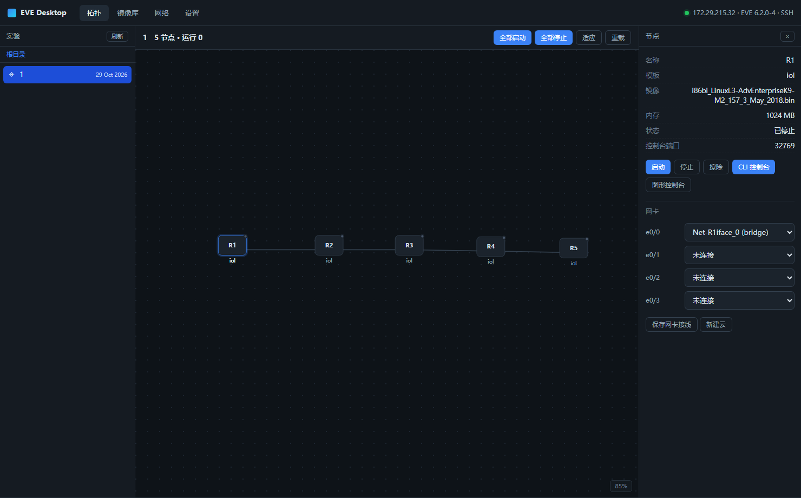

# EVE Desktop

[简体中文](README.md) ｜ **English**

A desktop client for EVE-NG: it folds the web UI's **lab/topology browsing, node control, built-in terminals, image import/export, and NIC / internet-uplink configuration** into one native window.

It is not an image repository and does not download images — images are only imported from your disk or exported from the server.



- Works with **Community 6.x** and **Pro 7.x** (capability probing, no version-number branching)
- Nothing to install on the EVE server (REST API + SSH only)
- All front-end assets ship inside the package — no CDN

---

## Features

| Area | What it does |
|---|---|
| Labs | Folder tree browsing, switching, deep links `#lab=<path>`, **new lab** (sidebar “+ New”: name / folder / description, opens automatically) |
| Topology | Canvas rendering of nodes, links and clouds; box-select, Ctrl/Shift multi-select, **right-drag / Space-drag / middle-drag / Alt+drag to pan**, wheel zoom, fit to window, per-lab view memory, context menus, 3-second status polling |
| Topology editing | Add nodes from templates (name / image / RAM / NIC count), drag to move (multi-select moves together), batch start-stop-delete, rename, create and delete networks, connect ports with interface names drawn on the links; writes carry `umtime` so they never clobber changes made in the EVE web UI |
| Node icons | Three optional shapes: **circle = router / horizontal bar = switch / vertical bar = firewall** (context menu or inspector, can be applied to a multi-selection) |
| Nodes | Start / stop / wipe, whole-lab batch start-stop, property view, NIC wiring editor, create cloud |
| Text boxes | Put **any number of free-form labels** on the canvas (right-click empty space → “Add text boxes…”, one input per box, “Add” appends two at a time): multi-line text, drag, marquee-select several and move them together, double-click to edit, right-click to delete/copy; three sizes and five colors. Stored locally, **never written into the `.unl`** |
| Move | **Export** a lab to a zip (topology + links + **node configs** + text boxes) and **import** it on any EVE to create a new lab; works across CE / Pro and across servers |
| Cleanup | Hover a lab in the list and an **✕** appears on its right; confirm to delete the whole topology (running nodes are stopped first). If it was the lab you had open, the canvas clears itself |
| Interface | **Chinese / English switch**, **dark / light theme switch**, both instant and remembered on this machine; covers all UI text including backend error messages |
| Terminals | Node CLI console (telnet over SSH), EVE host shell, GUI console (embedded EVE html5, covering VNC/RDP) |
| Capture | Start a capture on any NIC of a running node (tcpdump over SSH) — **Wireshark pops up locally and streams live** while the pcap is archived; BPF filters supported |
| Images | Scan the image library, import (tar/tgz/zip, SFTP with resume and progress), export a standard package (folder + yml + icon), one-click IOL licence repair |
| Network | pnet0–9 status, NAT uplink wizard (persistent, one-click removal) |
| Settings | Multiple server profiles, passwords encrypted with Windows DPAPI |

---

## Installation

### Option 1: installer (recommended, no Python needed)

Run `installer/Output/EVE-Desktop-Setup-<version>.exe`:

- All runtimes are bundled (PyInstaller), so it just works — no Python, no pip
- **Wireshark is never downloaded during setup**: the official mirrors are unreachable from
  much of the world (China especially), and a half-way “download failed” dialog looks like the
  install itself broke. When Wireshark is absent, the finish page offers an “open the Wireshark
  download page” checkbox (only opens your browser, hidden when already installed); the capture
  panel in the app has the same entry
- Want the setup to **bundle** Wireshark (offline, ~90 MB larger)? Drop the official installer
  in as `installer/vendor/Wireshark-x64.exe` before building — the wizard then offers
  “Install Wireshark” and installs it silently with no network
- The installer is roughly 15 MB; capture works without Wireshark too (the pcap is written
  locally in real time)

### Option 2: run from source

#### 1. Requirements

- Windows 10/11 (uses the built-in **WebView2**; present on Win11 — on Win10 install the
  [Edge WebView2 Runtime](https://developer.microsoft.com/microsoft-edge/webview2/) if missing)
- Python 3.10+

### 2. Install dependencies

```bash
pip install -r requirements.txt
```

### 3. Run

```bash
python app.py
```

On Windows the easy way is to **double-click `run.bat`** (no console window); use
`run-console.bat` when you want logs. Both scripts look for Python in this order:
local `.venv` → parent `.venv` → system `PATH`.

On start it **reconnects to the last saved server** (only for profiles with a stored
password) and lands on the lab list. To skip that:

```bash
python app.py --no-auto-connect
```

Other arguments:

| Argument | Purpose |
|---|---|
| `--lab 1.unl` | Open a specific lab on start |
| `--port 8765` | Fix the local service port (random by default) |
| `--debug` | Log every local API call to the console |
| `--no-gui` | Start only the local service, no window (automation/debugging) |

The Settings page asks for:

| Field | Notes |
|---|---|
| Server address | EVE's IP, e.g. `192.168.1.50` |
| API port | 80 by default (HTTPS needs the scheme below) |
| EVE user/password | The web login, `admin/eve` by default |
| “Also open SSH” | **Required** for image import/export, host shell and network setup — enter the root password |
| SSH user/port | `root` / `22` by default |

Then press “Save & connect”.

### 4. Build an exe (optional)

```bash
pip install pyinstaller
pyinstaller -w -n "EVE Desktop" ^
  --add-data "web;web" app.py
```

The result lands in `dist/EVE Desktop/EVE Desktop.exe`.

> `-w` hides the console; `--add-data` is mandatory, otherwise the window is blank
> (front-end assets were not packaged).

---

## Building the installer (development)

```bash
installer\build-installer.bat        # run from anywhere, it finds the venv itself
```

Two steps: PyInstaller produces `dist/EVE-Desktop/` (`EVE-Desktop.spec`), then Inno Setup
6.3+ (`installer/EVE-Desktop.iss`) compresses it into the setup. The Chinese wizard uses
`installer/ChineseSimplified.isl`.

Wireshark is **not** downloaded at setup time (it used to be `DownloadTemporaryFile` against
the official mirrors, which usually times out — a “download failed” dialog is worse than no
option at all). Instead:

- By default nothing is bundled: the finish page offers “open the Wireshark download page”
  (`Check: not WiresharkInstalled`, hidden when already installed)
- For an offline setup, rename the official installer to `installer/vendor/Wireshark-x64.exe`
  before building; `#if FileExists(...)` in the `.iss` switches on the bundled branch — the
  wizard offers “Install Wireshark” and installs it silently, no network. The resulting setup
  is named with a **`-full`** suffix (`EVE-Desktop-Setup-0.3.1-full.exe`) so the two kinds
  never overwrite each other. `vendor/` is gitignored so the 90 MB file never lands in the repo

The build script first makes sure it is running the **project venv** (it fails loudly if
`paramiko` or `pywebview` is missing instead of silently falling back to the system
python), then runs `installer/smoke_test.py`: it starts the built exe with `--no-gui` and
waits for `/api/state`. Pure-Python dependencies live inside the PYZ archive, so
`_internal/paramiko` never exists — “is the folder there” cannot verify a build, **you have
to actually run it**. Skip that step and the package dies on `ModuleNotFoundError: paramiko`.

## Self-testing (development)

```bash
# local service only, no window (debugging / automation), any port
python app.py --no-gui --port 18780
```

Then hit the endpoints with any HTTP client:

```bash
curl -s 127.0.0.1:18780/api/state
curl -s 127.0.0.1:18780/api/labs
```

The author also keeps a full-endpoint smoke script (start node → open console → wait for
prompt → run a command → stop node → clipboard round-trip, 22 checks), a phase-2 script
(create/move/delete nodes, concurrency guard, capture start-stop-save, launching Wireshark,
16 checks), a dual-version compatibility regression (27 checks each on CE/Pro), and a fake
EVE server (with a fake telnet) for UI work when no server is reachable. These scripts are
not published with the repository.

---

## Compatibility

The client **never branches on a version number**; it probes capabilities on connect
(`probe()` in `core/eve.py`):

| Difference | Community 6.x | Pro 7.x | Handling |
|---|---|---|---|
| Lab list | `GET /api/folders/` | `GET /api/labs` | Probe `/api/labs`; fall back to folders |
| Protocol | HTTP / 80 | **HTTPS / 443** (self-signed) | Selectable in Settings; when missing or wrong it guesses by port (443→https), retries the other one, and writes the winner back to the profile |
| GUI console | `/html5/` (guacamole) | Same (node JSON carries a tokenised URL) | Probe availability, hide the button when absent; the Pro certificate must be allowed explicitly (see below) |
| Network types | bridge + pnet0–9 | Also OVS | Whatever `GET /api/list/networks` returns |
| Node NICs | `ethernet` is a **dict** keyed by internal slot (e0/1 = 16) | `ethernet` is an **array**, index = port number | Normalised into a dict (key = port number) shared by wiring, capture and the inspector |
| Interface names | Vendor names only (`Gi0/0`, `Ethernet0/1`) | Internal names (`e0`, `e1`) | Both accepted when wiring; internal names map to port numbers by order |
| Creating nodes | `type` may be the template name | `type` **must be the real type** (`vios`→`qemu`) or you get a 400 | Read the template detail to get `type` first |
| Stopping nodes | `GET .../stop` | Requires `GET .../stop/stopmode=3`, else 400 | Try both forms, remember the one that works |
| Console port | fixed `32768 + id` | **Randomly assigned**, not in the API | Read the wrapper's `-C <port>` over SSH, matched by “lab uuid + node id” (the cwd is `/opt/unetlab/tmp/<tenant>/<uuid>/<id>`); fall back to the formula |
| Deleting networks/nodes | Error JSON when absent | **500 HTML** (Slim error page) | Re-check that it is really gone and treat it as success, so repeated deletes are idempotent |

New version differences **only touch `core/eve.py`**: add a probe to `probe()` and implement
the `EVECompat` semantics; business code stays untouched.

**Measured coverage** (`tools/test_compat.py`, **30/30 green on both CE 6.2.0-4 and Pro
7.2.0-4**): connection and capability probing, lab list, template list, new lab, read lab,
create node, node detail, batch NICs, move node, create bridge and wire it, wiring visible in
topology, direct-link bridges auto-hidden, disconnect/reconnect NIC, rename, start, status
change, **open/close node console**, stop, status reset after stop, delete node, create
network, delete network, idempotent repeated delete, image list (SSH), internet uplink (SSH),
capture session list.

```bash
# older CE (HTTP 80)
python tools/test_compat.py --host <CE_IP> --scheme http --port 80
# newer Pro (HTTPS 443, self-signed)
python tools/test_compat.py --host <PRO_IP> --scheme https --port 443
```

The script only touches the **temporary lab it creates** and deletes it afterwards
(including an SSH cleanup, because EVE's `DELETE /api/labs` does not remove the `.unl`).

### Known EVE-side quirks (handled by the client)

None of these are introduced by this tool; all were hit on both **EVE 6.2.0-4 (CE)** and
**7.2.0-4-PRO**, and all are worked around in code:

| Symptom | Cause | What the client does |
|---|---|---|
| “Start all” reports `Failed to start node` and only the first node starts | `unl_wrapper`'s `start()` calls `posix_setgid(32768)` in the **current process**, and IOL also calls `posix_setuid`. Starting several IOL nodes in one process means from the second one `tunctl` runs as `unl0` and fails with `TUNSETIFF: Operation not permitted` | “Start all” **calls each node separately** (one root process per node) and aggregates per-node results |
| After stop-then-start the NIC hits a stale tap | EVE does not clean up `vunl*` taps, and leftovers block the next start | Before starting, remove taps of “stopped nodes in this lab that are not UP”; `/api/lab/fixnet` does it manually |
| Node state reads as “stopped” while it runs | EVE status: `0` stopped / `1` ready / `2` running / `3` running+locked | Everything uses `>= 2` |
| IOL licence check always says “nothing missing” | `tmp/.../.prepared` is an empty **file** created by `touch`, not a directory | Look for the marker with `-type f` and take its dirname |
| Weird template names after import | `posixpath.basename` cannot split a Windows path (backslashes) | Use `os.path.basename`, and take the image name from the **package contents**, not the archive name |
| Wiring “succeeds” but the canvas shows no links | `PUT nodes/{id}/interfaces` **silently ignores unknown interface names** and still returns 200; CE uses `Gi0/0`, so sending `e0` does nothing | Both names are accepted, and after writing the network is re-checked to really have 2 interfaces — otherwise it raises instead of pretending |

---

## Topology editing (phase 2)

The canvas follows EVE's own habits:

| Action | How |
|---|---|
| Add node | Toolbar “+ Node” / right-click empty canvas → “Add node…” → template list (only templates with an installed image are selectable). Drag onto the canvas to place at the drop point, or click to drop it in the centre; a properties dialog follows |
| Editable properties | Name (auto-numbered, e.g. R6), image, RAM (MB), NIC count, serial count |
| Selection | Click to select; `Ctrl`/`Shift`+click to add; **drag on empty space = box select** (live highlight) |
| Pan / zoom | **Right-drag, Space+left-drag, middle-drag or `Alt`+left-drag** to pan; wheel zooms around the cursor; the `− 100% ＋ ⤢` control sits bottom-right; arrow keys nudge. **Each lab remembers its own view** |
| Moving | Drag a node; a multi-selection moves together. Dragging only changes local coordinates — it is written back to EVE **on release** |
| Right-click (empty) | **Add text boxes…** / Add node… / Add network (cloud)… / Select all nodes / Fit / Reset to 100% / Reload |
| Right-click (node) | CLI console, start, stop, properties…, **icon…**, link to network…, capture…, wipe, delete |
| Right-click (multi) | Batch start / stop / wipe / delete, bulk connect, **uniform icon…**, clear selection |
| Right-click (network) | Rename, delete |
| Wiring | 1) One dropdown per NIC in the inspector (also offers “+ New network…”); 2) right-click “Link to network…”; 3) **`Shift`+drag a node onto another node or a network icon** and pick the interfaces (dropping on a node creates an internal bridge by default, or you can pick an existing network) |
| Interface names | **Drawn on the links**: each link shows the interface the near node uses (e.g. `e0/0`); a direct node-to-node link carries a name at each end, so you see at a glance which ports are paired. Font size compensates for zoom (11–18 px). The inspector's NIC section still lists every interface with “connected / free” and a capture button |
| Direct links vs `Net-N` | A bridge with **exactly 2 interfaces** (what EVE creates for a “direct link”) gets **no network icon** — the line runs straight between the nodes with both interface names. Multiple cables between the same pair are drawn side by side. Press “Direct links” in the toolbar to show/rename/delete these bridges temporarily |

- **Concurrency guard**: every write carries the lab file's `umtime`. If you changed the same
  lab in the EVE web UI, the write is refused with “please reload first” — refusing to write
  beats silently overwriting each other.

### View (pan / zoom)

| Want to | How |
|---|---|
| Pan | **Right-drag**, **hold Space + left-drag**, middle-drag, or `Alt`+left-drag. A right-*click* without dragging still opens the context menu |
| Zoom | Wheel (anchored at the cursor, so zooming in never drifts), `＋` / `−` bottom-right, `Ctrl`+`=` / `Ctrl`+`-` |
| Back to 100% | Click the percentage bottom-right, or `Ctrl`+`1` |
| Fit to window | Toolbar “Fit”, the `⤢` button, or `Ctrl`+`0` |
| Small nudges | Arrow keys (80 px per press), `Shift`+arrow for 260 px |
| Trackpad | Two-finger vertical = zoom; two-finger horizontal = pan; `Shift`+wheel = pan |

**Each lab remembers its own view** (`localStorage` key `eve.view.<lab path>`): adjust it, close
the lab or restart the app, and you come back to the same spot. Only the first time a lab is
opened does it auto-fit, and redraws (icon changes, reloads) no longer throw the view away.
Click “Fit” whenever you want it re-fitted.

### New lab

Sidebar “Labs” → **+ New** → name (`.unl` is appended for you), folder (empty = root),
description (optional) → OK. The list refreshes and the lab opens immediately.

### Node icons

The default is a rounded box with the name. To draw a real-looking topology, right-click a
node (or use the inspector) → **Icon…**:

| Option | Shape | Usually means |
|---|---|---|
| Default | Rounded box | Anything |
| Circle | 48×48 circle | Router |
| Horizontal bar | 76×26 bar | Switch |
| Vertical bar | 34×64 bar (name rotated) | Firewall |

- “Uniform icon…” applies one choice to a whole multi-selection
- Icons are **a drawing preference only** — EVE's own `icon` field (an SVG path on the
  server) is untouched, so experiments cannot be damaged. Preferences are stored locally,
  keyed by “lab + node id”
- They do not travel to another machine/browser; pick “Default (box)” to reset

## Text boxes

Topologies usually need a few annotations (“core”, “access layer”, “NAT here”). An EVE `.unl`
only contains nodes and networks — there is no free text — so these labels are **stored
locally** and never touch the lab file (custom elements inside a `.unl` are silently dropped
by EVE, or break its parser).

Three entry points, same result:

| Entry | Behaviour |
|---|---|
| Right-click empty canvas → “Add text boxes…” | Boxes go where you right-clicked |
| Toolbar “+ Text” | Boxes go to the centre of the current view |
| Right-click an existing text box | Edit text / Copy text / Delete text box (“Delete N selected” when several are selected) |

**Adding many at once**: the dialog shows one input per text box — **one input = one text box**;
empty inputs are ignored. It opens with two inputs; each click on **Add** appends two more, as
many times as you like, and the `×` on a row removes that input. **Each box can hold several
lines — just press Enter inside it** (`Ctrl+Enter` submits). Boxes are laid out in columns without
overlapping (multi-line boxes are spaced by their real height). Size (small / medium / large) and
colour (default / blue / green / orange / red) apply to the whole batch.

Afterwards:

- **Drag** to move (written to disk on release; continuous drags are coalesced into one save)
- **Marquee-select** several, exactly like nodes: drag a rectangle from empty canvas and every
  box inside it gets selected; dragging any one of them then moves the whole group
  (`Shift`/`Ctrl` while dragging a rectangle adds to the selection)
- **Double-click** to edit in place (Enter inserts a line break; `Ctrl+Enter` saves, `Esc`
  cancels; emptying the text deletes the box)
- **Delete / Backspace** removes the selected boxes (all of them at once when several are selected)
- To change size or colour, delete and re-add the batch (or add a new one with other options)

> Stored in `%APPDATA%\eve-desktop\textboxes.json`, keyed by “server + lab path”, so
> different servers and labs never mix. **Opening the same lab on another computer will not
> bring the labels along**, because they are not inside the `.unl`. That is a deliberate
> trade-off: labels belong to this machine rather than polluting the lab file.

## Export / Import a topology

Move a lab from one server to another — **including every node's saved configuration** — or
just rebuild it somewhere else. The “Export” and “Import” buttons are on the toolbar, right
after “Reload”.

| Action | Result |
|---|---|
| **Export** | Opens the native “select folder” dialog first (starting where you exported last time; cancelling does nothing), then packs the lab into `<lab>-<timestamp>.zip`. When it finishes, a card in the bottom-right shows the **full path** with a “Show in folder” button (locates the zip in Explorer) and folds away after 25 seconds |
| **Import** | Pick a zip; a **new lab** is created on the currently connected server and opened automatically — topology, links, node properties, **node configs** and text boxes all come back |

> The task list lives on the Images page, so while you are on the topology page you would never
> see it — hence the separate result card. No page switching, no log digging: the path is right
> there. The folder picker remembers the last directory you chose.

Verified path: **CE 6.2 → Pro 7.2** (172.30.50.123 → 172.30.56.229). 10 nodes / 8 networks /
8 links all survived, and `name / template / image / ram / left / top` matched node by node.

Configs were verified item by item too: change the hostname on a device **without saving**,
export → import on the other server → start the node → the console prompt is the changed name
(`R1-LIVE#`, and `show run` agrees), not the stale config from the pack.

### What is inside the pack

| File | Contents |
|---|---|
| `manifest.json` | Format id and version, export time, source (server / version / lab path / lab id), node and network lists, whether each node has a config and **where it came from**, counts |
| `lab.unl` | The EVE lab file **as-is**: topology plus the node configs embedded in `<objects><configs>` |
| `textboxes.json` | The topology text boxes (local side-car data; without it they are lost) |
| `configs/<id>-<name>.cfg` | One **plain-text** config per node that has one — easy to read in any editor, and easy to write back node by node on import |

### Where the configs come from (in order of trust)

For every node the exporter takes the first source that yields something:

1. **Node is running → read the live `running-config` from the device**
   - This is the accurate one: if you typed a config on the device but never pressed “Save” in
     EVE, the `.unl` still holds the old version and only the device knows the new one
   - iOL goes through EVE's own path: `wrconf_iol.py -p <port>` makes the device write its config
     into NVRAM, then `iou_export` extracts it from `nvram_*`
   - qemu templates (vios / csr / nxos / vsrx …) use `config_scripts/<template script> -a get`
   - **linux / windows / docker are skipped** — they are not config-file driven devices
2. **Node not running → the config embedded in the `.unl`** (the one EVE saved)
3. Failing that → a leftover `startup-config` in the runtime directory

`manifest.json` records `config_source` (`device` / `unl` / `startup-config`) for every node, so
you can tell where a given device's config came from just by reading the manifest.

### Why the configs travel inside the `.unl`

`config="1"` on an EVE node is only a flag meaning “this node has a saved config”. The config
itself is not a node property — it lives in the lab file:

```xml
<lab>
  <objects>
    <configs>
      <config id="1">…base64 of the raw config text…</config>
    </configs>
  </objects>
</lab>
```

The two places in EVE that do this:

- **write**: `__lab.php:1338` → `$xml->objects->configs->addChild('config', base64_encode($config_data))`
- **read**: `cli.php:843` → `if ($n->getConfig()=='1' && $n->getConfigData()!='') dumpConfig(…, 'startup-config')`

So **copying the `.unl` copies the configs too**, and `/opt/unetlab/tmp/` never has to be touched.

**Note the two conditions on the read side**: having the config data is not enough — the node's
`config` attribute must be `"1"`. With the data present but the flag at `"0"`, EVE behaves as if
the node were never configured and does not produce a `startup-config`; the symptom is “the config
disappeared after import”. The importer switches that flag on explicitly and then re-reads the
file to verify, naming any node where it did not take.

> Do not try the other route — pre-creating the runtime directory on the target and dropping a
> `startup-config` into it. `cli.php:746` reads
> `if (is_dir($n->getRunningPath())) !touch(…'.prepared')`, and in PHP `!touch()` **still calls
> `touch()`**: as soon as the runtime directory exists, EVE considers the node “prepared” and
> skips all preparation (no IOL jail, no qemu linked clone), so the node can never start. We hit
> this one: `Failed to start node (12)` with `status` stuck at 0.

### What import does

1. Creates a **new lab** on the target server (never overwrites anything; on a name clash it
   becomes `name-1` and says so)
2. Writes the merged `.unl` and runs `chown www-data:www-data` + `chmod 644` **on that file only**
   (**never chmod the `/opt/unetlab/labs` directory** — stripping its `x` bit makes EVE unable to
   create any lab at all)
3. Re-parses it through the EVE API and compares node counts; on mismatch the file is deleted
   again, so no half-broken lab is left behind
4. **Writes the node configs and turns on the “use startup-config” switch**
   - CE 6.x: posts the config to `/api/labs/{path}/configs/{id}` (EVE persists it itself) and then
     sets `config` to `1` through the node edit endpoint
   - Pro 7.x: that API is encrypted in this build and cannot be called (we measured `500` /
     `60027` / `60061`), so the config rides entirely inside the `.unl` written in step 2 — this
     step only flips the flag
   - Finally the `.unl` is **read back and verified**: every node with a config must have both
     `<config>` and `config="1"`
5. Restores the text boxes (recorded for “target server + new lab path”, your existing labels
   are not overwritten)
6. Opens the lab

Node properties (template, image, RAM, NIC count, port wiring, canvas coordinates) are part of
the `.unl`, so they are complete on arrival. **On start EVE dumps the embedded config into
`startup-config`**, so pressing “Start” is all it takes — there is no separate “apply config” step.

### Requirements and limits

- **SSH is required**: reading and writing `.unl` files goes over SSH (the REST API does not
  expose the raw lab file). Without SSH configured you get a prompt to fill in the credentials
  and **nothing on the server is touched**.
- **The folder picker is the native Windows one.** Under `--no-gui`, or when you open the app in
  a plain browser, there is no window to attach a dialog to: the app says so and falls back to
  the default folder (the one used last time), so exporting still works.
- **64 MB pack limit** (enforced from `Content-Length`); real labs are tens of KB to a few MB.
- **Nodes must be running to capture an unsaved config**: the live read only happens while the
  node is up; with everything stopped you get the version saved in the `.unl`.
- **Capturing a config makes the device write once** (iOL's `wrconf` is effectively
  `write memory`). This is what EVE's own “export config” button does: it only stores the current
  `running-config` into the device NVRAM and changes nothing that is running.
- **linux / windows / docker node configs are not captured**: they have no `config_script`, are
  not config-file driven, and there is no equivalent to replay on import.
- **Images do not travel with the pack**: no qemu / iol image binaries inside. If the target
  lacks an image the topology still imports completely, but those nodes cannot start — import
  the image first. The result message names the nodes that are affected.
- **Runtime state does not travel**: imported nodes are all stopped, and temporary files from
  the runtime directory (logs, pids, intermediates) are not packed — EVE regenerates them anyway.
- **Unknown packs are rejected**: a missing `manifest.json`, a wrong `format`, or a pack newer
  than the app fails immediately and nothing is written to the lab library.
- **Unknown templates are rejected by EVE**: if a node uses a template the target EVE does not
  know at all (possible across major versions), EVE raises `invalid node template` while parsing,
  and the import deletes the file it just created and reports the error — no broken lab is left.
  A template that exists but has no image does **not** block the import; it is only mentioned in
  the result message.

## Deleting a topology

Labs pile up. **Hover a lab** in the sidebar and a small **✕** shows up on its right
(nothing is shown until you hover, so you cannot hit it by accident). Clicking it opens a
confirmation dialog that states **how many nodes the lab has** and **how many are running**.

- **It deletes the whole lab**: the `.unl` goes away together with its embedded node configs.
  **No undo.**
- **Running nodes are stopped first**, and that order is mandatory: Pro 7.2 refuses to delete
  a lab with running nodes (`400 Failed to delete Lab - Nodes still running (60069)`), while
  CE 6.2 answers 200 but leaves the processes and `/opt/unetlab/tmp/<tenant>/<uuid>` behind —
  which is exactly how nodes later end up fighting over ports and reporting a bogus `status` 2.
- After deleting, the lab is **read back to confirm the file is really gone** (EVE occasionally
  answers “success” without deleting). If it is still there you get an explicit error instead of
  a fake success.
- If the lab was the one you had open, the canvas closes and returns to “No lab selected”.
- Cancel, clicking outside, and `Esc` all leave it alone; in a destructive dialog the focus sits
  on **Cancel**, so pressing Enter cannot delete anything by accident.
- Only labs are deleted, **folders are not**: an emptied folder stays behind — remove it in the
  EVE web UI if you want it gone.

## Interface language and theme

Two buttons at the top right, effective immediately — **no restart**:

| Button | Effect |
|---|---|
| `EN` / `中文` | Switch the UI language (the label shows what a click will give you) |
| `Light` / `Dark` | Switch the theme; light suits projectors and daylight, dark suits long sessions |

- Coverage: static UI, dynamically generated dialogs/menus/toasts, and the common backend
  error messages
- **Not translated**: your lab and node names (that is your data), input values such as
  usernames and passwords, and file names under `eve-captures`
- The choice is kept in WebView2's localStorage (`eve.lang` / `eve.theme`) and restored on
  the next launch
- Implementation: a runtime dictionary keyed by the Chinese source text (`web/i18n.js`,
  with `{}` wildcard support), so new copy only needs one dictionary entry instead of
  markers scattered through the templates

## Capture (Wireshark)

The web UI's capture button uses the custom `capture://<host>/vunl0_1_0` protocol handled by
the locally installed “EVE Client” helper; **CE's REST API has no capture endpoint**. This
client goes over SSH but still gives you “click and watch packets scroll”:

1. A node NIC is a host tap, and **the two EVE generations name them differently**:
   - CE 6.x: `vunl{tenant}_{node id}_{port index}`
   - Pro 7.x: `vun` + four hex fields `{lab:3}{tenant:4}{node id:3}{port:2}`,
     so lab 1 / tenant 0 / node 1 `e0/0` is `vun001000000100`
   - The port index is not a sequence number: `e0/0`=0, `e0/1`=16 (16 slots per NIC).
     The client computes both names, asks the server which one actually exists, and if
     neither matches it falls back to scanning `vun*` for “node id + port index”, so a
     future rename in EVE will not break capture
2. Over SSH it runs `tcpdump -i <tap> -s 0 -U -n -w -` in the foreground; stdout is a raw pcap stream
3. A local thread does two things at once: writes
   `Documents\eve-captures\<lab>_<node>_<nic>_<time>.pcap` and feeds the same bytes into
   `wireshark -k -i -` — so Wireshark opens and starts scrolling immediately
4. Stop: send `SIGINT` to the remote tcpdump and close Wireshark's stdin. The file has been
   written locally all along, nothing to copy back
5. **Closing the Wireshark window stops the capture** and kills the remote tcpdump; packets
   captured so far stay in the local file

**Usage**: right-click a node → “Capture…” → pick a NIC; or use the capture button next to
each NIC in the inspector. The bottom-left panel shows live **packet count / size / duration**
per session and has “Stop & save”.

- Only **running** nodes can be captured (EVE creates the tap at start); you get a clear message otherwise
- Without Wireshark nothing fails: the pcap is still written and its path is shown. The capture
  panel adds a “**Get Wireshark**” button (opens your system browser, so you can pick a mirror or
  use a proxy) — the setup wizard never downloads it for you
- Filters use BPF syntax, e.g. `tcp port 80`, `icmp`, `host 10.0.0.1`; only ordinary
  characters are accepted (no `;` or `$`) to keep the command injection-free

## Internet access

Three ways for lab devices to reach the internet (all covered by the “Network” page):

1. **Cloud0 straight to the LAN**: create a network of type `pnet0`. `pnet0` is the
   management bridge, so nodes get addresses from your corporate/school DHCP — same subnet as EVE.
2. **NAT uplink (recommended, works with a single NIC)**: on the “Network” page pick `pnetN`
   plus the uplink NIC → Create. This will, on the server:
   - create the `pnetN` bridge with gateway `10.255.N.1/24`
   - write `/etc/dnsmasq.d/eve-nat-pnetN.conf` for DHCP
   - enable `ip_forward` and `MASQUERADE`
   - generate `/opt/eve-desktop/nat-pnetN.sh` and a systemd unit (when “enable on boot” is checked)

   Then create a `pnetN` cloud in the topology and attach nodes; the pool is
   `10.255.N.100-200`, gateway `10.255.N.1`. “Remove” deletes the bridge, the rules and the
   unit, **without touching `/etc/network/interfaces`**.

   > **Pick the NIC that carries the default route.** EVE bridges `eth0` into `pnet0`, so the
   > IP and default route live on `pnet0`; choosing `eth0` out of habit makes
   > `MASQUERADE -o eth0` never match (iptables counters stay at 0, symptom: “NAT configured
   > but no internet”). The client detects this and marks the NIC with “· default route”.

   > **DHCP needs dnsmasq.** Some EVE images ship without it (`command -v dnsmasq` empty);
   > the bridge and NAT still work but no addresses are handed out. The client says so and
   > you must configure static IPs `10.255.N.100/24`, gateway `10.255.N.1`, or
   > `apt-get install -y dnsmasq` and recreate.
3. **Bind a physical NIC to pnetN**: needs a second NIC on the server. This tool only shows
   the binding; it will not edit `/etc/network/interfaces` for you (a mistake there can cut
   you off the management network).

> `pnet0` is the management network; every write to it is refused.

---

## Terminals

- **Node CLI console**: connects straight to the remote console port over SSH (an `ssh -L`
  equivalent), so no firewall rule for 32768+ is needed. A minimal telnet negotiation is
  implemented: `WILL ECHO` answered with `DO` (the device echoes, since xterm does not echo
  locally), `WILL SGA/TTYPE` answered with `DO`, `DO *` always `WONT` (stay in NVT).
  **Window size (NAWS) is only sent when the device asks for it** — measured: IOL never
  negotiates NAWS, and forcing it injects `\x00` payloads as keystrokes, corrupting the
  command line (`R1>Z`, `% Invalid input`).
- **Host shell**: SSH PTY, `Ctrl+Shift+T` to open.
- **Copy & paste (SecureCRT habits)**:
  - **Select to copy**: release the mouse and the selection is already on the clipboard
  - **Right-click = paste**: no menu first; multi-line text has newlines turned into carriage returns so commands run one by one
  - Keys: `Ctrl+Shift+C` copy, `Ctrl+Shift+V` or `Shift+Insert` paste; `Ctrl+C` copies when
    there is a selection and sends an interrupt otherwise; `Ctrl+Insert` copy
  - The clipboard is the **system clipboard** (`core/clip.py`, plain ctypes), so it
    interoperates with SecureCRT / Notepad / browsers and avoids WebView2 clipboard permissions
- **GUI console**: embeds EVE's own `/html5/` page (with token) for VNC/RDP nodes. Linux and
  Windows templates use `console = vnc|rdp` and have **no serial port**, so those nodes only
  offer the GUI console.
- **Self-signed certificates**: newer EVE serves HTTPS on 443 with a self-signed certificate,
  and the GUI console is an `<iframe>` living in WebView2's own network stack (the Python
  client does not verify certificates at all), so by default you get
  `NET::ERR_CERT_AUTHORITY_INVALID` — “this page seems broken / your connection is not
  private”. At startup the client pushes the **public-key fingerprint** of every HTTPS
  server in your profiles into `--ignore-certificate-errors-spki-list`
  (`core/h5trust.py`), **allowing only that one certificate** instead of a global
  `--ignore-certificate-errors`; other sites keep normal verification.
  - The fingerprint is written into the profile when you connect and applies on the **next launch**; the current session logs a note
  - If the server's certificate changes (reinstall / renewal) it is recomputed on the next launch
  - The flag can only be set once at process start, so a newly added server needs a client restart

---

## Layout

```
app.py              entry point (pywebview window + local service)
core/
  config.py         config and DPAPI password storage
  eve.py            EVE REST client + capability probing (single place for version differences)
  remote.py         SSH: exec / sftp / port forwarding / PTY
  term.py           terminal sessions, telnet negotiation, SSE streaming
  images.py         image scan / import / export / IOL licence
  netcfg.py         pnet inspection / NAT uplink
  capture.py        capture (server-side tcpdump + streaming + local Wireshark)
  clip.py           Windows clipboard access (ctypes, for the terminal)
  notes.py          topology text boxes (local sidecar file, never inside .unl)
  labpack.py        topology export / import (.unl moved as-is, embedded node configs included)
  fspick.py         native folder picker / reveal a file in the file manager
  server.py         local HTTP routes (binds 127.0.0.1 only)
  tasks.py          background tasks and progress
web/                front end (xterm.js vendored locally, i18n.js for language/theme)
```

> `web/vendor/` contains [xterm.js](https://github.com/xtermjs/xterm.js) and
> `@xterm/addon-fit`, both MIT licensed and vendored so no CDN is required.

---

## Troubleshooting

| Symptom | Cause / fix |
|---|---|
| Blank window on launch | `--add-data "web;web"` missing from the build |
| “Response was not JSON (HTTP 500)” | EVE's web service is unhappy or **the password is empty**. Open `http://<ip>/api/status` in a browser and check `/var/log/apache2/error.log` |
| “Response was not JSON (HTTP 400)” against Pro | Wrong protocol: newer EVE runs **HTTPS on 443**, plain HTTP gets a 400. Select HTTPS (or let the automatic probe fix it) |
| “No EVE password saved yet” | The profile has no password (new machine / wiped config): re-enter it in Settings |
| Only the topology works, the image page demands SSH | Wrong SSH password/port, or port 22 is firewalled |
| Console is blank and keys do nothing | The node is not running, or its `console` is `vnc/rdp` (use the GUI console) |
| GUI console shows “your connection is not private / NET::ERR_CERT_AUTHORITY_INVALID” | Self-signed certificate. The client allows that server's certificate at startup; **a newly added server needs a restart**. Also make sure the profile uses HTTPS on 443 |
| “Cannot reach console port 32769” on Pro | Old bug: Pro assigns console ports **randomly**. Fixed by reading the real port from the wrapper process over SSH; the GUI console still works as a fallback |
| “Node R1 is not running yet (console port 32769 not listening)” | Expected: the port only listens while the node runs. Start it first |
| Console still fails right after start | IOL needs ~2–5 s; check with `ss -lntp \| grep 32769` on the host shell |
| `KeyError: 'id'` or `int() argument must be … not 'NoneType'` | Old bug: EVE returns node collections keyed by id with no `id` field inside. Fixed |
| Console renders but typing shows no echo | That template is VNC, not telnet |
| Images do not appear after import | The directory name does not start with the template name; such rows are flagged |
| “Start all” only starts one node | EVE's IOL privilege-drop issue, see above; use this client's “Start all” |
| Nodes have no internet after NAT | Wrong uplink NIC (should be the default-route one, usually `pnet0`), or dnsmasq missing |
| “Session was taken over by another client (90001)” | **EVE allows one session per account.** The web UI, another client, a script — they kick each other. Close the others, or give this tool its own EVE account |
| Everything returns 412 after working before | Same cause; the client re-logs in once automatically |
| “The lab was modified elsewhere, please reload” | `umtime` changed. Press “Reload” |
| `Request not valid (60027)` on stop (Pro) | Old bug: Pro requires `stopmode`. Fixed |
| `HTTP 500 Slim Application Error` when deleting | Pro returns 500 HTML for already-deleted objects. Fixed with a re-check |
| Most templates greyed out in “+ Node” | Those templates have no image on the host (`.missing` in `/api/list/templates`). Import the image first |
| A new node will not start | Template defaults (image/RAM) point at a missing image; check the node's “image” field |
| “Node is not running” when capturing | Only running nodes have a tap NIC |
| A capture saved 0 packets | That link really was idle. Make a device ping first |
| Wireshark not found | Install [Wireshark](https://www.wireshark.org/); the file is already saved and its path is shown |
| `tcpdump: command not found` | `apt-get install -y tcpdump` on the server |
| Dragging pans the canvas instead of moving a node | Left-drag on empty space is box-select (EVE habit); pan with **right-drag**, **hold Space and drag**, middle-drag or `Alt`+left-drag |
| “This feature needs SSH” on export/import | Packs read and write the `.unl` on the server, and the REST API does not expose the raw file. Fill in the SSH credentials under Settings (EVE default `root/eve`) |
| Clicking Export starts packing without a folder dialog | There is no GUI window (`--no-gui`, or the page is open in a plain browser). It falls back to the last used folder; the path on the result card is where the file went |
| Import fails with “EVE could not parse the topology, rolled back: invalid node template …” | The pack uses a template that EVE on the target does not know (possible across major versions). The file just created was deleted, so no broken lab is left; switch those nodes to a template the target has |
| Import succeeded but warns “Images are missing on this server, these nodes cannot start” | The topology is complete; the images just are not installed. Import them from the image library, then start the nodes |
| Nodes start after import but their config is empty | Check whether the pack has a `configs/<id>-….cfg` for that node. If not, nothing could be captured on the source: the node was stopped and the `.unl` had no saved config either. **Export again with the nodes running**; linux / windows nodes never have a config to carry |
| Import warns “these nodes have a config but the switch is off” | The config reached the `.unl` but the node's `config` flag could not be set to `1`, so EVE will not dump it into `startup-config`. Importing again retries it; if it still fails, set Startup-Config manually in the node settings |
| Import warns “the config API is not available” | Expected on Pro 7.x: its config API is encrypted and cannot be called, so the config rides inside the `.unl` instead. Nothing is lost — imported nodes load their config on start on Pro too (measured) |
| `% Invalid input at '^'` after typing | Old bug with NAWS before negotiation. Fixed |

---

## Security

- The local service binds `127.0.0.1` only, on a random port, and is never exposed.
- Passwords live in `%APPDATA%\eve-desktop\config.json`, encrypted with **Windows DPAPI**
  (tied to the current user; not decryptable on another machine or account). Plaintext
  entries from older versions are converted on the next save.
- Every dangerous action (wipe, remove NAT, uninstall) asks for confirmation; writes to
  `pnet0` are refused outright.
