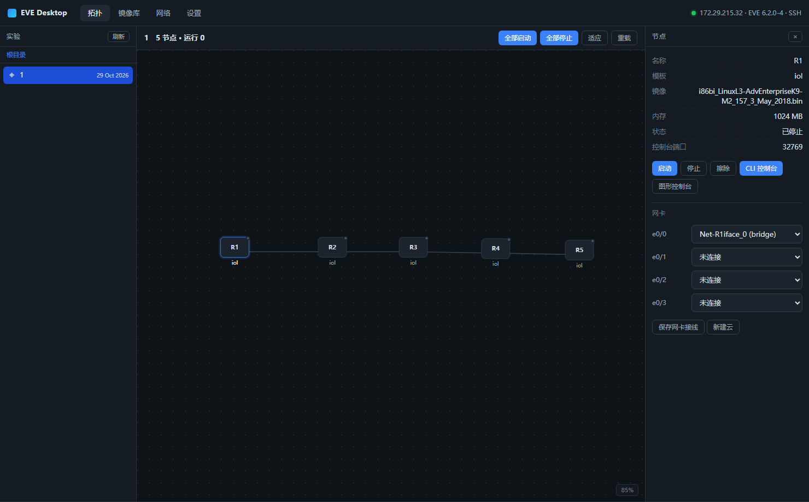

# EVE Desktop

EVE-NG 桌面客户端：把网页版的**实验/拓扑浏览、节点操控、内置终端、镜像导入导出、网卡与外网出口配置**收进一个原生窗口里。

不做镜像源，不做在线下载 —— 镜像只从本地导入、或从服务器导出。



- 兼容 **Community 6.x** 与 **Pro 7.x**（按能力探测，不按版本号硬编码）
- 不需要在 EVE 服务器上安装任何东西（仅用它的 REST API + SSH）
- 前端 HTML/JS 全部随包提供，不依赖外网 CDN

---

## 功能

| 模块 | 能力 |
|---|---|
| 实验 | 目录树浏览、切换、深链 `#lab=<path>` |
| 拓扑 | 画布渲染节点/连线/云，滚轮缩放、拖拽平移、适应窗口、3 秒轮询运行状态 |
| 拓扑编辑 | 模板库拖拽/点击新建节点、拖动节点改位置、改名、删除节点、新建与删除网络、改网卡接线；写操作带 `umtime` 比对，避免盖掉 EVE 网页版的修改 |
| 节点 | 启动 / 停止 / 擦除、整实验批量启停、属性查看、网卡接线编辑、新建云 |
| 终端 | 节点 CLI 控制台（telnet over SSH）、EVE 主机 Shell、图形控制台（内嵌 EVE html5，覆盖 VNC/RDP） |
| 抓包 | 运行中节点的任一网卡开抓（tcpdump），随时停止并回传本机，直接用 Wireshark 打开；支持 BPF 过滤 |
| 镜像 | 扫描镜像库、导入（tar/tgz/zip，SFTP 断点续传+进度）、导出标准包（目录+yml+图标）、IOL 许可证一键修复 |
| 网络 | pnet0–9 状态、NAT 出口向导（可持久化、可一键卸载） |
| 设置 | 多服务器 profile，密码用 Windows DPAPI 加密保存 |

---

## 安装

### 1. 运行环境

- Windows 10/11（依赖系统自带的 **WebView2**，Win11 默认已装；Win10 若缺，安装 [Edge WebView2 Runtime](https://developer.microsoft.com/microsoft-edge/webview2/)）
- Python 3.10+

### 2. 装依赖

```bash
pip install -r requirements.txt
```

国内网络可换源：

```bash
pip install -i https://mirrors.aliyun.com/pypi/simple/ -r requirements.txt
```

### 3. 运行

```bash
python app.py
```

Windows 上更省事：**双击 `run.bat`**（无控制台窗口）；要看日志或排错用 `run-console.bat`。
两个脚本都会依次找 Python：本目录 `.venv` → 上级 `.venv` → 系统 `PATH`。

启动后会**自动连接上次保存的服务器**（只对存过密码的 profile 生效），打开就是拓扑列表。
不想自动连就加参数：

```bash
python app.py --no-auto-connect
```

其他启动参数：

| 参数 | 作用 |
|---|---|
| `--lab 1.unl` | 启动后直接打开某个实验（省得每次点） |
| `--port 8765` | 固定本地服务端口（默认随机） |
| `--debug` | 把每个本地接口调用打到控制台，排错用 |
| `--no-gui` | 只起本地服务，不开窗口（自动化/调试） |

首次启动会弹「设置」页，填：

| 字段 | 说明 |
|---|---|
| 服务器地址 | EVE 的 IP，如 `192.168.1.50` |
| API 端口 | 默认 80（HTTPS 需改 scheme，见下） |
| EVE 账号/密码 | 网页登录用的账号，默认 `admin/eve` |
| 勾选「同时建立 SSH 连接」 | 镜像导入导出、主机终端、网络配置**必须**；填 root 密码 |
| SSH 用户/端口 | 默认 `root` / `22` |

点「保存并连接」。

### 4. 打包成 exe（可选）

```bash
pip install pyinstaller
pyinstaller -w -n "EVE Desktop" ^
  --add-data "web;web" app.py
```

产物在 `dist/EVE Desktop/EVE Desktop.exe`。

> `-w` 关闭控制台窗口；`--add-data` 必须带，否则窗口白屏（前端资源没打进去）。

---

## 自测（开发用）

```bash
# 只起本地服务，不开窗口（调试、自动化用），端口任选
python app.py --no-gui --port 18780
```

之后可用任意 HTTP 客户端逐条打接口，验证连接与拓扑：

```bash
curl -s 127.0.0.1:18780/api/state
curl -s 127.0.0.1:18780/api/labs
```

开发时作者另有一支全接口冒烟脚本（起节点 → 开控制台 → 等提示符 → 下发命令 → 停节点 → 剪贴板读写，共 22 项），
一支二期功能脚本（新建/移动/删除节点、并发保护、抓包起停存、调起 Wireshark，共 16 项），
以及一支「假 EVE」（含假 telnet，服务器不可达时联调界面用），这些脚本不随仓库发布。

---

## 兼容性

客户端**不读版本号做分支**，而是连接时探测能力（`core/eve.py` 的 `probe()`）：

| 差异点 | Community 6.x | Pro 7.x | 处理 |
|---|---|---|---|
| 实验列表 | `GET /api/folders/` | `GET /api/labs` | 探测 `/api/labs` 是否 200，失败回落 folders |
| 控制台端口 | `32768 + id` | `32768 + 128*tenant + id` | 端口由 `/api/auth` 的 `tenant` 计算 |
| 图形控制台 | `/html5/`（guacamole） | 同 | 探测可用性，不可用则不显示按钮 |
| 网络类型 | bridge + pnet0–9 | 另含 OVS | 以 `GET /api/list/networks` 返回为准 |

新增版本差异**只需要改 `core/eve.py`**：`probe()` 里加一项探测、`EVECompat` 语义落到对应方法，业务代码不用动。

### 已知的 EVE 侧坑位（客户端已适配）

这些不是本工具引入的，是实测中在 EVE 6.2.0-4 上踩到的，代码里都做了兜底：

| 现象 | 原因 | 客户端的处理 |
|---|---|---|
| 「全部启动」报 `Failed to start node`，只有第一个节点起来 | `unl_wrapper` 的 `start()` 在**当前进程**里 `posix_setgid(32768)`，IOL 还会 `posix_setuid`。批量启动时所有 IOL 节点在一个进程里顺序启动，从第二个起就以 `unl0` 身份 `tunctl`，报 `TUNSETIFF: Operation not permitted` | 「全部启动」改为**逐节点调用**（每次一个独立进程，root 起），并汇总每个节点的结果 |
| 停完再启动，同名 tap 冲突 | EVE 停节点不回收 `vunl*` tap，残留的会挡住下次启动 | 启动前自动清理「本实验已停止节点 + 未 UP」的 tap；也可手动调 `/api/lab/fixnet` |
| 节点状态判断成"已停止" | EVE 状态值：`0` 停止 / `1` 就绪 / `2` 运行 / `3` 运行且锁定 | 统一按 `>= 2` 判运行 |
| IOL 许可证检查总是"无缺失" | `tmp/.../.prepared` 是 `touch` 出来的**空文件**，不是目录 | 用 `-type f` 找标记文件，再取 dirname |
| 导入后镜像列表出现奇怪模板名 | 从 Windows 上传的本地路径用 `posixpath.basename` 拆不出文件名（反斜杠） | 改用 `os.path.basename`，且镜像名以**包内容**为准，不信压缩包文件名 |

---

## 拓扑编辑（二期）

- **新建节点**：工具栏「＋ 节点」打开模板库（156 个模板，只有装了镜像的能选，其余灰掉）。
  拖到画布上按落点放，或直接单击放到画布中央。新节点会自动带上模板默认值
  （镜像、内存、网卡数……，EVE 自己不补，缺了要等启动才炸）。
- **移动节点**：直接在画布上拖，松手才写回 EVE（拖动过程只改本地坐标，不刷请求）。
- **改名 / 删除**：节点右键或右侧检查器。
- **接线**：检查器里每块网卡一个下拉框，选网络后「保存网卡接线」。
- **删除网络**：在网络（云）图标上右键。
- **并发保护**：每次写操作都带上实验文件的 `umtime`。如果你同时在 EVE 网页版里改了这个
  实验，写操作会被拒绝并提示「请先重载」——宁可不写，也不要互相盖掉。

## 抓包（Wireshark）

EVE 网页版那个抓包按钮用的是 `capture://<host>/vunl0_1_0` 自定义协议，交给本机装的
「EVE Client」插件去开 Wireshark；**CE 的 REST API 里没有抓包接口**。所以这里直接走 SSH：

1. 节点网卡在宿主机上是 tap `vunl{tenant}_{节点id}_{接口编号}`（`e0/0`=0、`e0/1`=16……）
2. 服务器上 `tcpdump -i <tap> -s 0 -U -n -w /var/tmp/eve-desktop-cap/<sid>.pcap` 后台跑
3. 停止时发 `SIGINT`（只有 SIGINT 才会 flush 出完整 pcap），再 SFTP 拉回本机
4. 存到 `我的文档\eve-captures\<实验>_<节点>_<网卡>_<时间>.pcap`，然后直接调起本机 Wireshark

**用法**：节点右键 →「抓包…」→ 选网卡；或检查器里每块网卡后面的「抓包」。左下角面板能看到
正在抓的会话（实时文件大小、时长），点「停止并保存」就落盘并打开 Wireshark。

- 只能抓**运行中**的节点（EVE 只在运行态建 tap），节点没起来会直接提示
- 过滤器按 BPF 语法填，例如 `tcp port 80`、`icmp`、`host 10.0.0.1`；
  为避免命令注入，只接受常规字符，出现 `;` `$` 之类会拒绝
- 抓包文件放 `/var/tmp`（磁盘，不是内存盘），避免长时间抓包吃掉 RAM
- 本机没装 Wireshark 时不会报错，会告诉你文件在哪，装好再双击也行

## 外网出口怎么配

拓扑里的设备要上网，三条路（GUI 的「网络」页都覆盖）：

1. **Cloud0 直连**：新建网络选 `pnet0`。`pnet0` 就是管理网桥，节点会直接从公司/学校 DHCP 拿地址，等于和 EVE 同网段。
2. **NAT 出口（推荐，单网卡也能用）**：「网络」页选 `pnetN` + 出口网卡 → 创建。会在服务器上：
   - 建 `pnetN` 网桥 + 网关 `10.255.N.1/24`
   - 写 `/etc/dnsmasq.d/eve-nat-pnetN.conf` 下发 DHCP
   - 开 `ip_forward` + `MASQUERADE`
   - 生成 `/opt/eve-desktop/nat-pnetN.sh` 与 systemd unit（勾选「开机自动生效」时）

   然后在拓扑里新建 `pnetN` 云，节点接上去即可；IP 段 `10.255.N.100-200`，网关 `10.255.N.1`。
   点「卸载」会删桥、删规则、删 unit，**不改 `/etc/network/interfaces`**。

   > **出口网卡一定要选「默认路由所在的那块」**。EVE 把 `eth0` 桥进了 `pnet0`，
   > IP 和默认路由都在 `pnet0` 上；照习惯选 `eth0`，`MASQUERADE -o eth0` 就永远匹配不到包
   > （iptables 计数一直是 0，现象是"NAT 配好了但上不了网"）。
   > 客户端会自动探测并在下拉框里标出「· 默认路由」。

   > **DHCP 依赖 dnsmasq**。有些 EVE 镜像里没装 dnsmasq（`command -v dnsmasq` 为空），
   > 这时桥和 NAT 都正常但不会下发地址，客户端会明确提示，节点需手工配静态 IP
   > `10.255.N.100/24`、网关 `10.255.N.1`；或先 `apt-get install -y dnsmasq` 再重建。
3. **给 pnetN 绑物理网卡**：需要服务器有多块网卡。本工具只展示绑定关系，不自动改 `/etc/network/interfaces`（写错会断管理网，得不偿失，建议用 EVE 自带界面或手工改）。

> `pnet0` 是管理网，工具里任何写操作都会拒绝。

---

## 终端说明

- **节点 CLI 控制台**：走 SSH 直连远端控制台端口（`ssh -L` 等价物），不要求防火墙放行 32768+。
  内置极简 telnet 协商：`WILL ECHO` 回 `DO`（由设备回显，因为 xterm 不做本地回显）、
  `WILL SGA/TTYPE` 回 `DO`、`DO *` 一律 `WONT`（保持 NVT，不进二进制）。
  **窗口尺寸（NAWS）只在设备主动协商过时才发**——实测 IOL 不协商 NAWS，
  硬发会把 `\x00` 之类的载荷当成键盘输入，命令行立刻被污染（`R1>Z`、`% Invalid input`）。
- **主机 Shell**：SSH PTY，`Ctrl+Shift+T` 快速打开。
- **复制粘贴（SecureCRT 习惯）**：
  - **选中即复制**：拖选完一松开鼠标就进剪贴板，右上角会提示「已复制 N 字符」
  - **右键 = 粘贴**：不用先点菜单；多行文本会自动把换行转成回车，逐条执行
  - 键盘：`Ctrl+Shift+C` 复制、`Ctrl+Shift+V` 或 `Shift+Insert` 粘贴；
    `Ctrl+C` 有选区时复制、没有选区时照常发中断；`Ctrl+Insert` 复制
  - 剪贴板走的是**系统剪贴板**（`core/clip.py`，纯 ctypes），所以能跟 SecureCRT /
    记事本 / 浏览器互通，也不受 WebView2 剪贴板权限限制
- **图形控制台**：内嵌 EVE 自带 `/html5/` 页面（带 token），VNC/RDP 类节点用它。
  需要你的浏览器能直接访问 EVE 的 80 端口。

---

## 目录结构

```
app.py              启动入口（pywebview 窗口 + 本地服务）
core/
  config.py         配置与 DPAPI 密码存储
  eve.py            EVE REST 客户端 + 能力探测（版本差异唯一收敛点）
  remote.py         SSH：exec / sftp / 端口通道 / PTY
  term.py           终端会话、telnet 协商、SSE 增量推流
  images.py         镜像扫描 / 导入 / 导出 / IOL 许可证
  netcfg.py         pnet 查看 / NAT 出口
  capture.py        抓包（服务器端 tcpdump + 回传 + 调起本机 Wireshark）
  clip.py           Windows 剪贴板读写（ctypes，供终端复制粘贴）
  server.py         本地 HTTP 路由（只监听 127.0.0.1）
  tasks.py          后台任务与进度
web/                前端（xterm.js 已本地化到 vendor/）
```

> `web/vendor/` 里是 [xterm.js](https://github.com/xtermjs/xterm.js) 与 `@xterm/addon-fit`，均为 MIT 许可，
> 已本地化随包提供，不依赖外网 CDN。

---

## 故障排查

| 现象 | 原因 / 处理 |
|---|---|
| 打开就白屏 | 打包时漏了 `--add-data "web;web"` |
| 连不上，提示「返回不是 JSON（HTTP 500）」 | EVE 的 Web 服务异常或**密码为空**。现在提示里会带 HTTP 码与常见原因；先浏览器打开 `http://<ip>/api/status` 确认，再看服务器 `/var/log/apache2/error.log` |
| 提示「还没保存 EVE 密码」 | profile 里没有密码（换机器/删过配置）：到「设置」重填账号密码并保存 |
| 只能看拓扑，镜像页提示需要 SSH | SSH 密码/端口不对，或被服务器防火墙拦了 22 |
| 控制台一片空白、按键无反应 | 节点没启动；或节点 `console` 设成了 `vnc/rdp`（改用「图形控制台」） |
| 打开 CLI 提示「节点 R1 还没启动（控制台端口 32769 未监听）」 | 正常限制：EVE 的控制台端口只在节点运行时才监听。先在右侧面板点「启动」，状态变成「运行」再开 |
| 打开 CLI 提示「连不上控制台端口」 | 节点刚启动要等几秒（IOL 约 2–5s）；一直失败用主机终端 `ss -lntp \| grep 32769` 看是否真的在听 |
| 右侧「启动/停止」报 `KeyError: 'id'`，或开 CLI 报 `int() argument must be … not 'NoneType'` | 旧版本 bug：EVE 的 `/api/labs/x/nodes` 只把 id 放在对象键上，元素本身没有 `id`，前端发回 `undefined` 就炸。已修（统一补 id），更新到当前版本 |
| 控制台能显示但输入没回显 | 该模板是 VNC 类型，不是 telnet |
| 导入后镜像列表没有 | 镜像目录名与模板名对不上（EVE 规则是"目录名以模板名开头"），列表里会标黄「无模板」 |
| 全部启动只起来一个 | EVE 批量的 IOL 降权问题，见上文；用本客户端的「全部启动」（逐节点）即可 |
| NAT 建好后节点上不了网 | 出口网卡选错（应当是默认路由那块，EVE 里通常是 `pnet0`）；或无 dnsmasq 导致没拿到地址 |
| 提示「会话被其它客户端顶掉（90001）」 | **EVE 同一账号只允许一个会话**。浏览器里的 EVE 页面、另一台机器上的客户端、命令行脚本都会互相踢。关掉其它端再操作，或给本工具单独建一个 EVE 账号 |
| 之前能用，突然所有请求都 412 | 同上，会话被顶掉了；客户端会自动重登一次，仍失败就说明账号正被别处占用 |
| 写操作提示「实验已被别处修改，请先重载」 | `umtime` 变了：EVE 网页版或另一个窗口改过这个实验。点工具栏「重载」再操作 |
| 点了「＋ 节点」模板大片灰掉 | 那些模板宿主机上没装镜像（`/api/list/templates` 里带 `.missing`）。先到「镜像库」导入对应镜像 |
| 新建的节点启动不起来 | 模板的默认参数（镜像/内存）被 EVE 记下了但镜像不存在：检查节点「镜像」字段，或先导入镜像 |
| 抓包提示「节点还没运行」 | 只能在运行中的节点上抓；EVE 是节点启动后才建 `vunl*` tap |
| 抓包保存下来 0 个包 | 那条链路上真没流量（IOL 不配地址时通常什么都不发）。先让设备 ping 一下再抓 |
| 抓包提示没找到 Wireshark | 装 [Wireshark](https://www.wireshark.org/) 后重试；文件本身已经存好了，路径会提示出来 |
| 抓包报 `tcpdump: command not found` | 服务器没装 tcpdump：`apt-get install -y tcpdump` |
| 输入命令出现 `% Invalid input at '^'` | 旧版本在未协商 NAWS 时会发窗口尺寸；已修，更新到当前版本 |

---

## 安全说明

- 本地服务只绑定 `127.0.0.1`，随机端口，不对外暴露。
- 密码保存在 `%APPDATA%\eve-desktop\config.json`，用 **Windows DPAPI**（当前用户绑定）加密；换机器/换用户不可解密。
  保存时加密、读取时解密；早期版本留下的明文条目会在下次保存时自动转成密文。
- 所有危险操作（擦除、删除 NAT、卸载）都会二次确认；`pnet0` 写操作直接拒绝。
