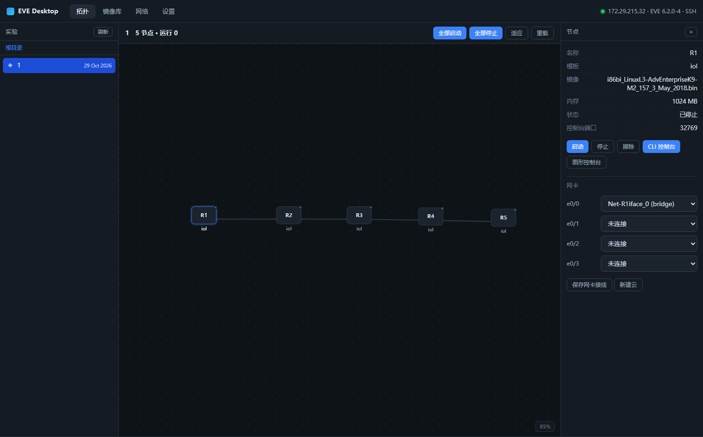

# EVE Desktop

**简体中文** ｜ [English](README.en.md)

EVE-NG 桌面客户端：把网页版的**实验/拓扑浏览、节点操控、内置终端、镜像导入导出、网卡与外网出口配置**收进一个原生窗口里。

不做镜像源，不做在线下载 —— 镜像只从本地导入、或从服务器导出。



- 兼容 **Community 6.x** 与 **Pro 7.x**（按能力探测，不按版本号硬编码）
- 不需要在 EVE 服务器上安装任何东西（仅用它的 REST API + SSH）
- 前端 HTML/JS 全部随包提供，不依赖外网 CDN

---

## 功能

| 模块 | 能力 |
|---|---|
| 实验 | 目录树浏览、切换、深链 `#lab=<path>`、**新建实验**（左侧「＋ 新建」：填名字/目录/说明，建完自动打开） |
| 拓扑 | 画布渲染节点/连线/云，框选、Ctrl/Shift 加选、**右键拖 / 空格拖 / 中键 / Alt+左键平移视角**、滚轮缩放、适应窗口、每个实验各记一份视角、右键菜单、3 秒轮询运行状态 |
| 拓扑编辑 | 模板库新建节点（属性框可改名字/镜像/内存/网卡数）、拖动改位置（多选一起拖动）、批量启停/删除、改名、新建与删除网络、接线并在链路上标注接口名、**点线选中后删线**；写操作带 `umtime` 比对，避免盖掉 EVE 网页版的修改 |
| 节点图标 | 三种可选形状：**圆形＝路由器 / 横置长方体＝交换机 / 竖置长方体＝防火墙**（右键菜单或检查器切换，支持多选统一设置） |
| 节点 | 启动 / 停止 / 擦除、整实验批量启停、属性查看、网卡接线编辑、新建云 |
| 终端 | 节点 CLI 控制台（telnet over SSH）、EVE 主机 Shell、图形控制台（内嵌 EVE html5，覆盖 VNC/RDP） |
| 抓包 | 运行中节点的任一网卡开抓（tcpdump over SSH），**点开就在本机 Wireshark 里实时滚包**，同时落盘留档；支持 BPF 过滤 |
| 镜像 | 扫描镜像库、导入（tar/tgz/zip，SFTP 断点续传+进度）、导出标准包（目录+yml+图标）、IOL 许可证一键修复 |
| 网络 | pnet0–9 状态、NAT 出口向导（可持久化、可一键卸载） |
| 文本框 | 画布上放**任意多个自由文本**（右键空白处 →「添加文本框…」，一行一个输入框，点「增加」一次加两个）：可多行、可拖动、可框选多个一起拖、双击改字、右键删/复制；字号与颜色可选。存在本机，**不写进 `.unl`** |
| 搬运 | **导出**成 zip（拓扑 + 连线 + **节点配置** + 文本框）→ **导入**到任意一台 EVE 自动建成新实验；可跨 CE / Pro、跨服务器 |
| 清理 | 列表里指到实验项，右边露出 **✕**，确认后删掉整个拓扑（在跑的节点会先停掉）；删的是当前打开的实验时画布自动收摊 |
| 界面 | **中文 / English 一键切换**、**暗色 / 亮色主题一键切换**，选择记在本机，下次打开还是这套；覆盖全部界面文案（含后端报错） |
| 设置 | 多服务器 profile，密码用 Windows DPAPI 加密保存 |

---

## 安装

### 方式一：安装包（推荐，无需 Python）

运行 `installer/Output/EVE-Desktop-Setup-<版本>.exe`：

- 内置全部运行时（PyInstaller 打包），装完即用，不需要 Python 和 pip
- **安装时不会联网下载 Wireshark**：官方镜像在国内基本连不上，装到一半弹「下载失败」
  反而像是安装出了问题。本机没有 Wireshark 时，安装完成页会多一条「打开 Wireshark
  下载页」（勾了才开浏览器，本机已装则不显示）；应用里的抓包面板也有同一个入口
- 想让安装包**自带** Wireshark（离线可用，包体 +约 90MB）：把官方安装器重命名成
  `installer/vendor/Wireshark-x64.exe` 再打包，安装向导就会出现「安装 Wireshark」，
  勾上直接离线静默安装（已装过自动跳过）
- 安装包本身约 15MB；没装 Wireshark 也能抓包（包实时存在本机，装好后再打开看回放）

### 方式二：源码运行

#### 1. 运行环境

- Windows 10/11（依赖系统自带的 **WebView2**，Win11 默认已装；Win10 若缺，安装 [Edge WebView2 Runtime](https://developer.microsoft.com/microsoft-edge/webview2/)）
- Python 3.10+

### 2. 装依赖

```bash
pip install -r requirements.txt
```

国内网络可换源：

```bash
pip install -i https://mirrors.aliyun.com/pypi/simple/ -r requirements.txt
```

### 3. 运行

```bash
python app.py
```

Windows 上更省事：**双击 `run.bat`**（无控制台窗口）；要看日志或排错用 `run-console.bat`。
两个脚本都会依次找 Python：本目录 `.venv` → 上级 `.venv` → 系统 `PATH`。

启动后会**自动连接上次保存的服务器**（只对存过密码的 profile 生效），打开就是拓扑列表。
不想自动连就加参数：

```bash
python app.py --no-auto-connect
```

其他启动参数：

| 参数 | 作用 |
|---|---|
| `--lab 1.unl` | 启动后直接打开某个实验（省得每次点） |
| `--port 8765` | 固定本地服务端口（默认随机） |
| `--debug` | 把每个本地接口调用打到控制台，排错用 |
| `--no-gui` | 只起本地服务，不开窗口（自动化/调试） |

首次启动会弹「设置」页，填：

| 字段 | 说明 |
|---|---|
| 服务器地址 | EVE 的 IP，如 `192.168.1.50` |
| API 端口 | 默认 80（HTTPS 需改 scheme，见下） |
| EVE 账号/密码 | 网页登录用的账号，默认 `admin/eve` |
| 勾选「同时建立 SSH 连接」 | 镜像导入导出、主机终端、网络配置**必须**；填 root 密码 |
| SSH 用户/端口 | 默认 `root` / `22` |

点「保存并连接」。

### 4. 打包成 exe（可选）

```bash
pip install pyinstaller
pyinstaller -w -n "EVE Desktop" ^
  --add-data "web;web" app.py
```

产物在 `dist/EVE Desktop/EVE Desktop.exe`。

> `-w` 关闭控制台窗口；`--add-data` 必须带，否则窗口白屏（前端资源没打进去）。

---

## 打安装包（开发用）

```bash
installer\build-installer.bat        # 在哪个目录运行都行，脚本自己找 venv
```

两步：PyInstaller 打出 `dist/EVE-Desktop/`（`EVE-Desktop.spec`），再由
Inno Setup 6.3+（`installer/EVE-Desktop.iss`）压成安装包。中文界面用
`installer/ChineseSimplified.isl`（官方仓库 Unofficial 翻译）。

Wireshark **不在安装时下载**（原先是 `DownloadTemporaryFile` 拉官方直链，国内基本超时，
弹「下载失败」比不提供更糟）。现在的做法：

- 默认不随包：安装完成页多一条「打开 Wireshark 下载页」（`Check: not WiresharkInstalled`，
  本机已装则不显示），勾了才开浏览器
- 需要离线包时：把官方安装器重命名成 `installer/vendor/Wireshark-x64.exe` 放进去，
  `.iss` 里 `#if FileExists(...)` 会自动打开随包分支 —— 安装向导出现「安装 Wireshark」，
  静默安装，全程不联网。产出的安装包文件名会带 **`-full`**
  （`EVE-Desktop-Setup-0.3.3-full.exe`），和普通包区分开。
  `vendor/` 已进 `.gitignore`，不会把 90MB 提交上去

打包脚本会先确认用的是**项目 venv**（缺 `paramiko` 或 `pywebview` 直接报错，不会偷偷
退回系统 python），打完再跑 `installer/smoke_test.py`：以 `--no-gui` 起一次 exe，
等 `/api/state` 应答。纯 Python 依赖是打进 PYZ 归档的，`_internal` 里根本没有
`paramiko` 目录，所以「看文件在不在」判断不了依赖是否打全 —— **必须真跑一次**。
漏了这步，出来的包双击就是 `ModuleNotFoundError: paramiko`。

## 自测（开发用）

```bash
# 只起本地服务，不开窗口（调试、自动化用），端口任选
python app.py --no-gui --port 18780
```

之后可用任意 HTTP 客户端逐条打接口，验证连接与拓扑：

```bash
curl -s 127.0.0.1:18780/api/state
curl -s 127.0.0.1:18780/api/labs
```

开发时作者另有一支全接口冒烟脚本（起节点 → 开控制台 → 等提示符 → 下发命令 → 停节点 → 剪贴板读写，共 22 项），
一支二期功能脚本（新建/移动/删除节点、并发保护、抓包起停存、调起 Wireshark，共 16 项），
一支双版本兼容回归脚本（CE/Pro 各 27 项），
以及一支「假 EVE」（含假 telnet，服务器不可达时联调界面用），这些脚本不随仓库发布。

---

## 兼容性

客户端**不读版本号做分支**，而是连接时探测能力（`core/eve.py` 的 `probe()`）：

| 差异点 | Community 6.x | Pro 7.x | 处理 |
|---|---|---|---|
| 实验列表 | `GET /api/folders/` | `GET /api/labs` | 探测 `/api/labs` 是否 200，失败回落 folders |
| 连接协议 | HTTP / 80 | **HTTPS / 443**（自签证书） | 设置页可选；配置里没写或填错时，按端口猜（443→https），失败再换另一种试，成功后写回配置 |
| 图形控制台 | `/html5/`（guacamole） | 同（节点 JSON 直接给带 token 的 url） | 探测可用性，不可用则不显示按钮；新版是自签证书，内嵌浏览器需单独放行（见下） |
| 网络类型 | bridge + pnet0–9 | 另含 OVS | 以 `GET /api/list/networks` 返回为准 |
| 节点网卡 | `ethernet` 是**字典**，键是内部槽位号（e0/1 = 16） | `ethernet` 是**数组**，下标即接口号 | 读回来统一成字典（键＝接口号），接线/抓包/检查器共用一套逻辑 |
| 接口名 | 只有厂商真名（`Gi0/0`、`Ethernet0/1`） | 内部名（`e0`、`e1`） | 改接线时名字和内部名都认；内部名按**顺序**换算成接口号，两套命名都能命中 |
| 新建节点 | `type` 可填模板名 | `type` **必须是真实类型**（`vios`→`qemu`），否则 400 | 建节点前读模板详情取 `type` |
| 停止节点 | `GET .../stop` | 必须 `GET .../stop/stopmode=3`，否则 400 | 两种写法都试，通了就记住，下次直接用对的那种 |
| 控制台端口 | 定值 `32768 + id` | **随机分配**（API 不返回），起节点时由服务端挑 | 走 SSH 读 wrapper 进程参数 `-C <端口>`，按「实验 uuid + 节点 id」匹配（工作目录就是 `/opt/unetlab/tmp/<tenant>/<uuid>/<id>`）；查不到再退回公式 |
| 删网络/节点 | 删不存在的返回错误 JSON | 删不存在的返回 **500 HTML**（Slim 错误页） | 先复核一遍确实没了就当成功（重复删除幂等），批量删除才不会假失败 |

新增版本差异**只需要改 `core/eve.py`**：`probe()` 里加一项探测、`EVECompat` 语义落到对应方法，业务代码不用动。

**实测覆盖**（`tools/test_compat.py`，CE 6.2.0-4 与 Pro 7.2.0-4 **各 30 项全绿**）：
连接与能力探测、实验列表、模板列表、新建实验、读实验、建节点、节点详情、批量网卡、移动节点、
新建桥接线、接线落到拓扑、直连桥自动隐藏、断开/接回网卡、改名、启动、状态变化、
**打开/关闭节点控制台**、停止、停止后状态归零、删除节点、新建网络、删除网络、重复删网络幂等、
镜像列表（SSH）、外网出口（SSH）、抓包会话列表。

```bash
# 旧版 CE（HTTP 80）
python tools/test_compat.py --host <CE_IP> --scheme http --port 80
# 新版 Pro（HTTPS 443，自签证书）
python tools/test_compat.py --host <PRO_IP> --scheme https --port 443
```

脚本只碰自己新建的**临时实验**，跑完自动删掉（连 SSH 清理残留文件 —— EVE 的 `DELETE /api/labs`
本身不删 `.unl`）。

### 已知的 EVE 侧坑位（客户端已适配）

这些不是本工具引入的，实测中在 **EVE 6.2.0-4（CE）** 和 **7.2.0-4-PRO** 上都踩到过，代码里都做了兜底：

| 现象 | 原因 | 客户端的处理 |
|---|---|---|
| 「全部启动」报 `Failed to start node`，只有第一个节点起来 | `unl_wrapper` 的 `start()` 在**当前进程**里 `posix_setgid(32768)`，IOL 还会 `posix_setuid`。批量启动时所有 IOL 节点在一个进程里顺序启动，从第二个起就以 `unl0` 身份 `tunctl`，报 `TUNSETIFF: Operation not permitted` | 「全部启动」改为**逐节点调用**（每次一个独立进程，root 起），并汇总每个节点的结果 |
| 停完再启动，同名 tap 冲突 | EVE 停节点不回收 `vunl*` tap，残留的会挡住下次启动 | 启动前自动清理「本实验已停止节点 + 未 UP」的 tap；也可手动调 `/api/lab/fixnet` |
| 节点状态判断成"已停止" | EVE 状态值：`0` 停止 / `1` 就绪 / `2` 运行 / `3` 运行且锁定 | 统一按 `>= 2` 判运行 |
| IOL 许可证检查总是"无缺失" | `tmp/.../.prepared` 是 `touch` 出来的**空文件**，不是目录 | 用 `-type f` 找标记文件，再取 dirname |
| 导入后镜像列表出现奇怪模板名 | 从 Windows 上传的本地路径用 `posixpath.basename` 拆不出文件名（反斜杠） | 改用 `os.path.basename`，且镜像名以**包内容**为准，不信压缩包文件名 |
| 接线「成功」但画布上一根线都没有 | `PUT nodes/{id}/interfaces` 对**不认识的接口名是静默忽略**的，照样回 200；CE 的接口叫 `Gi0/0`，传 `e0` 就白传 | 接口名与内部名互认；写完复核网络上真的挂了 2 个接口，否则直接报错，不再假成功 |

---

## 拓扑编辑（二期）

画布按 EVE 网页版的习惯来：

| 操作 | 说明 |
|---|---|
| 新建节点 | 工具栏「＋ 节点」/ 画布空白右键「添加节点…」→ 模板库（只有装了镜像的模板能选）。拖到画布按落点放，或单击放中央，随后**弹出属性框** |
| 属性框里能改 | 名称（自动取下一个编号，如 R6）、镜像、内存 (MB)、网卡数量、串口数量 |
| 选中 | 单击单选；`Ctrl`/`Shift`+点击加选；在空白处**左键拖 = 框选**（实时高亮命中节点） |
| 平移 / 缩放 | **右键拖 / 空格+左键拖 / 中键拖 / `Alt`+左键拖** 都能平移；滚轮缩放（以光标为中心）；右下角 `− 100% ＋ ⤢`；方向键微移。**每个实验各记一份视角**，下次打开回到原位 |
| 移动 | 直接拖节点，多选时一起移；**云 / 网络图标也能拖**（`.unl` 里 network 同样有坐标）；拖动过程只改本地坐标，**松手才写回** EVE |
| 右键（空白） | **添加文本框…** / 添加节点… / 添加网络（云）… / 全选节点 / 适应窗口 / 恢复 100% / 重新加载 |
| 右键（节点） | CLI 控制台、启动、停止、属性…、**图标…**、接线到网络…、抓包…、擦除、删除 |
| 右键（多选） | 批量启动 / 停止 / 擦除 / 删除、批量接线、**统一图标…**、取消选择 |
| 右键（网络） | 重命名、删除 |
| 接线 | ① 检查器每块网卡一个下拉（也能选「＋ 新建网络…」）；② 右键「接线到网络…」；③ **`Shift`+拖动节点到另一个节点 / 网络图标**上松开，选接口即接上（拖到节点上默认新建内部桥，也可选已有网络）|
| 看接口 | **接口名直接标在链路上**：每条连线靠近节点的一侧写该节点用的接口（如 `e0/0`），两个节点直连时这一条线两端各有一个名字，一眼就能看出互联的是哪两个口；字号随缩放补偿（保持 11–18px 可读）。检查器「网卡」区仍列出全部接口与「已连/未连」，后面直接有「抓包」 |
| 删线 | **左键点线**选中（靠近线 10px 内即可，缩到 25% 也点得中），右侧检查器换成「这条线」并给出 **删除这条线**；也可以**右键线**→删除，或选中后按 `Delete` / `Backspace`。删的是**线**不是网络：只把两端的网卡从那个桥上摘下来，网络本身留着，别的线不受影响。鼠标移到线上会变手型并高亮，所以不点也知道它能选 |
| 直连与 `Net-N` | 只挂 **2 个接口**的桥（EVE 里两个节点「直连」时后台就是这个）**不画网络图标**，线直接连两个节点，两端标接口名；两个节点之间有多根网线时并排画。要临时看见/改名/删除这些桥，点工具栏「直连」切换显示 |

- **并发保护**：每次写操作都带上实验文件的 `umtime`。如果你同时在 EVE 网页版里改了这个
  实验，写操作会被拒绝并提示「请先重载」——宁可不写，也不要互相盖掉。

### 视角（平移 / 缩放）

| 想做什么 | 怎么做 |
|---|---|
| 平移 | **右键拖** / **按住空格 + 左键拖** / 中键拖 / `Alt`+左键拖。右键**不拖**仍然是右键菜单 |
| 缩放 | 滚轮（以鼠标位置为锚点，放大不会跑偏）、右下角 `＋` `−`、`Ctrl`+`=` / `Ctrl`+`-` |
| 回到 100% | 点右下角的百分比，或 `Ctrl`+`1` |
| 适应窗口 | 工具栏「适应」、右下角 `⤢`，或 `Ctrl`+`0` |
| 小幅挪动 | 方向键（每次 80px），`Shift`+方向键 260px |
| 触控板 | 两指上下滑＝缩放，两指横滑＝左右平移，`Shift`+滚轮＝左右平移 |

**视角按实验各记一份**（`localStorage` 键 `eve.view.<实验路径>`）：调好位置后关掉再打开、
甚至重启程序，回到的还是上次那个位置；只有第一次打开某个实验才自动「适应窗口」，
改图标、重载这类重绘也不会再把视角冲掉。想重新适应就点「适应」。

### 新建实验

左侧「实验」面板顶部 **＋ 新建** → 填实验名（自动补 `.unl`，不用自己写）、所在目录（留空＝根）、
说明（可空）→ 确定。建完列表自动刷新并直接打开，省得再去 EVE 网页版开一次。

### 节点图标

默认是圆角方框 + 名字；想画成真实网络拓扑的图形，右键节点（或选中后在右侧检查器）点 **图标…**：

| 选项 | 形状 | 通常代表 |
|---|---|---|
| 默认 | 圆角方框 | 任意设备 |
| 圆形 | 48×48 圆形 | 路由器 |
| 横置长方体 | 76×26 横条 | 交换机 |
| 竖置长方体 | 34×64 竖条（名字竖排） | 防火墙 |

- 多选后点「统一图标…」可以一次刷一批（例如把一屏交换机全设成横条）
- 图标只是**画布上的画法**，不改 EVE 的数据（EVE 自己的 `icon` 字段是服务器上的 SVG 文件路径，
  这里没动它），所以不会把实验改坏；偏好按「实验 + 节点 id」存在浏览器本地
- 换机器/换浏览器要重设；想恢复原样选「默认（方框）」

## 文本框

拓扑里除了设备和连线，还经常要写几行说明（「核心区」「接入层」「此处做 NAT」）。
EVE 的 `.unl` 只有节点和网络两种对象，没有自由文本，所以这类标注**存在本机**，
不碰实验文件（往 `.unl` 里塞自定义元素会被 EVE 静默丢掉，甚至解析失败）。

三种入口，效果一样：

| 入口 | 说明 |
|---|---|
| 画布空白处**右键** →「添加文本框…」 | 文本框放在你右键的位置 |
| 工具栏「＋ 文本」 | 放在当前视图中央 |
| 右键已有文本框 | 编辑文字 / 复制文字 / 删除文本框（选中多个时是「删除选中的 N 个」） |

**一次放多个**：弹窗里一行一个输入框，**一个输入框 = 一个文本框**，空的自动忽略。
打开时给两个，点「增加」一次再添两个，想要多少个就点多少次；每个框右边的 `×`
可以删掉多余的输入行。**每个框内部可以按回车换行**（`Ctrl+Enter` 才提交）。
多个框会自动按列铺开、互不重叠（多行的框按实际高度错开）；字号（小/中/大）与颜色
（默认/蓝/绿/橙/红）整批一起设。

放好之后：

- **拖动**改位置（松手才写盘，连续拖动会合并成一次保存）
- **框选**多个：和选节点一样，在空白处按住左键拉一个矩形，框到的文本框会一起选中，
  再拖其中任意一个就是整组移动；`Shift`/`Ctrl` 拉框是加选
- **双击**原地改字（框里可以敲回车换行；`Ctrl+Enter` 保存、`Esc` 放弃；清空内容＝删掉这个框）
- **Delete / Backspace** 删掉选中的文本框（选中多个时一次全删）
- 字号/颜色想改就删掉重加一批（或直接改弹窗里的选项重新放）

> 存在 `%APPDATA%\eve-desktop\textboxes.json`，按「服务器 + 实验路径」分开记，
> 换机器/换实验互不干扰。**换一台电脑打开同一个实验，文本框不会跟过去**
> —— 因为它们不在 `.unl` 里。这是有意的取舍：宁可标注是本机的，也不要污染实验文件。

## 导出 / 导入拓扑

把一台服务器上的实验**连同每个节点的配置**搬到另一台（或者换个环境重做一遍）。
工具栏上的「导出」和「导入」两个按钮，就在「重载」右边。

| 动作 | 结果 |
|---|---|
| **导出** | 先弹系统原生的「选择文件夹」框（默认停在上次选过的目录，取消就什么都不做），选定后打包成 `<实验名>-<时间戳>.zip`。完成后右下角浮一张卡片写明**完整路径**，带「打开文件夹」按钮（直接定位到那个 zip），25 秒后自动收起 |
| **导入** | 选一个 zip，在**当前连着的服务器**上新建一个实验并自动打开；拓扑、连线、节点属性、**节点配置**、文本框全都在 |

> 任务列表长在「镜像库」页里，导出时人在拓扑页看不到它，所以导出结果单独浮一张卡
> —— 不用切页、也不用去翻日志就知道东西存哪了。下次再导出，目录选择框会停在上次的位置。

已经实测过的路径：**CE 6.2 → Pro 7.2**（172.30.50.123 → 172.30.56.229），
10 节点 / 8 网络 / 8 条连线一条不少，逐节点比对 `name / template / image / ram / left / top`
完全一致。

配置也逐条验过：在设备上改完 hostname **不点保存**，导出 → 导入到另一台 →
启动节点 → 控制台提示符就是改过的那个名字（`R1-LIVE#`，`show run` 里对得上），
不是包里的旧配置。

### 包里有什么

| 文件 | 内容 |
|---|---|
| `manifest.json` | 格式标识与版本、导出时间、来源（服务器 / 版本 / 实验路径 / 实验 id）、节点与网络清单、每个节点是否有配置及**配置从哪来**、各项计数 |
| `lab.unl` | EVE 实验文件**原样**：拓扑 + 内嵌在 `<objects><configs>` 里的节点配置 |
| `textboxes.json` | 拓扑文本框（本机侧车数据，不带上就丢了） |
| `configs/<id>-<名字>.cfg` | 每个有配置的节点一份**纯文本**配置，方便直接用文本编辑器看、也方便导入时逐台写回 |

### 配置从哪来（按可信度）

导出时对每个节点按这个顺序取，取到就用：

1. **节点正在运行 → 直接从设备抓**当前 `running-config`
   - 这是最准的：你在设备里敲了配置但**没在 EVE 里点「保存」**，`.unl` 里还是旧的，
     只有设备上是最新的
   - iOL 走 EVE 自己的流程：`wrconf_iol.py -p <端口>` 让设备把配置写进 NVRAM，
     再从 `nvram_*` 里用 `iou_export` 抽出来
   - qemu 类（vios / csr / nxos / vsrx …）走 `config_scripts/<模板脚本> -a get`
   - **linux / windows / docker 不抓**（它们不是配置文件驱动的设备，抓了也没意义）
2. **节点没在运行 → 用 `.unl` 里内嵌的配置**（你在 EVE 里保存过的那份）
3. 再不行 → 运行目录里残留下来的 `startup-config`

`manifest.json` 里每个节点都记了 `config_source`（`device` / `unl` / `startup-config`），
点一下包里的清单就知道某台设备的配置是从哪拿的。

### 为什么配置跟着 `.unl` 走

EVE 节点上的 `config="1"` 只是一个「这个节点有保存的配置」的标记，配置正文并不在节点属性里，
而是存在实验文件的这个位置：

```xml
<lab>
  <objects>
    <configs>
      <config id="1">…base64 的原始配置文本…</config>
    </configs>
  </objects>
</lab>
```

对应 EVE 自己的两处代码：

- **写**：`__lab.php:1338` → `$xml->objects->configs->addChild('config', base64_encode($config_data))`
- **读**：`cli.php:843` → `if ($n->getConfig()=='1' && $n->getConfigData()!='') dumpConfig(…, 'startup-config')`

**注意读的那一行有两个条件**：光有配置数据还不够，节点属性 `config` 必须是 `"1"`。
数据写进去了、属性还是 `"0"`，EVE 就当没配过，启动时不会生成 `startup-config`
—— 表现就是「导入后打开实验，配置看着没了」。导入时会显式把这个开关打开，
并且写完再读回来复核一遍，没打开的在提示里点名。

所以**搬 `.unl` 就等于连配置一起搬了**，完全不用碰 `/opt/unetlab/tmp/`。

> 反过来也别想着「先在目标机预建运行目录、再塞一个 `startup-config` 进去」——
> `cli.php:746` 是 `if (is_dir($n->getRunningPath())) !touch(…'.prepared')`，
> PHP 里 `!touch()` **照样会执行 `touch()`**：只要运行目录存在，EVE 就认定「已 prepare」
> 并跳过全部准备工作（IOL 不建 jail、qemu 不做 linked clone），节点必定起不来。
> 我们踩过这个坑，现象是 `Failed to start node (12)`、`status` 恒为 0。

### 导入之后做了什么

1. 在目标服务器上**新建一个实验**（不会覆盖已有实验；同名时自动改成 `名字-1`，并在提示里说明）
2. 把合并后的 `.unl` 写进去，**只对这个文件**做 `chown www-data:www-data` + `chmod 644`
   （**千万别对 `/opt/unetlab/labs` 目录 chmod**：把它的 `x` 位抹掉，EVE 立刻建不了任何实验）
3. 用 EVE 的 API 重新解析一遍，核对节点数；对不上就把这个文件删掉回滚，不留半成品
4. **写节点配置并打开「使用配置」开关**
   - CE 6.x：走 `/api/labs/{path}/configs/{id}` 把配置写进去（EVE 自己落盘），
     再用节点编辑接口把 `config` 置为 `1`
   - Pro 7.x：这套接口在这版里是加密的、调不通（实测回 `500` / `60027` / `60061`），
     所以配置只由 `.unl` 承载 —— 第 2 步已经写好了，这里只负责打开开关
   - 最后**读回 `.unl` 复核**：每个有配置的节点都必须 `<config>` 在、`config="1"` 也在
5. 恢复文本框（按「目标服务器 + 新实验路径」重新记一份，不覆盖你原有的标注）
6. 自动打开这个实验

节点属性（模板、镜像、内存、网卡数、接口接线、画布坐标）本来就在 `.unl` 里，导入即完整；
**启动节点时 EVE 会把内嵌配置 dump 成 `startup-config`**，所以点「启动」配置就生效，
不需要再单独做一次「应用配置」。

### 硬性要求与边界

- **必须有 SSH**：读 `.unl`、写 `.unl` 都走 SSH（REST API 不提供实验文件的原文件读写）。
  没配 SSH 会直接提示去填账号，**不会动服务器上的任何东西**。
- **目录选择框是系统原生的**（Windows 的「选择文件夹」）。用 `--no-gui` 或直接用浏览器
  打开时没有图形窗口，弹不出选择框 —— 这时会提示一句并退回默认目录（上次用过的那个），
  功能不中断。
- **包上限 64 MB**（服务端按 `Content-Length` 拦），正常实验从几十 KB 到几 MB。
- **必须开着节点，才能抓到「没保存」的配置**：节点在运行时才会去设备上读；
  全部停着的时候只能拿到 `.unl` 里保存过的那份。
- **抓配置会让设备执行一次写操作**（iOL 的 `wrconf` 相当于 `write memory`）：
  这是 EVE 自己「导出配置」按钮的同款做法，只把当前 `running-config` 存进设备 NVRAM，
  不改动任何运行中的配置。
- **linux / windows / docker 节点的配置不抓**：它们没有 `config_script`，不是配置文件
  驱动的设备，导入后也没有可回放的等价物。
- **镜像不随包走**：包里没有 qemu / iol 镜像本体。目标机缺对应镜像时拓扑照样完整导入，
  但那些节点起不来 —— 先用「镜像 → 导入」把镜像补上。导入结果的提示里会列出缺哪些。
- **运行状态不随包走**：节点导入后一律是停止状态；运行目录里的临时文件（日志、pid、
  中间产物）也不打包，它们本来就该由 EVE 重新生成。
- **不认识的包会被拒绝**：`manifest.json` 缺失、`format` 不对、包版本比程序新，都会直接报错，
  不会写进实验库。
- **不认识的模板会被 EVE 拒绝**：包里某个节点用了目标机 EVE 完全不认识的模板（跨大版本时
  可能遇到），EVE 解析 `.unl` 时直接抛 `invalid node template`，导入会删掉刚建的文件并报错
  —— 不会留下一个坏实验。模板存在但镜像没装的情况**不影响导入**，只在结果提示里点出
  哪几个节点起不来。

## 删除拓扑

实验攒多了要清，列表里**指到某一项**，右边才露出一个 **✕**（不悬停不显示，免得误点）。
点它弹确认框，里面写清**这个实验有几个节点**、**几个正在跑**，确认之后才动手。

- **删的是整个实验**：`.unl` 连同内嵌的节点配置一起消失，**不可恢复**
- **在跑的节点会先停掉再删**，顺序是硬性的：Pro 7.2 在节点运行时直接删会回
  `400 Failed to delete Lab - Nodes still running (60069)`；CE 6.2 虽然回 200，
  但会把进程和 `/opt/unetlab/tmp/<tenant>/<uuid>` 留下 —— 后面起节点抢端口、
  `status` 假报 2 就是这么来的
- 删完**会再读一遍确认文件真的没了**（EVE 偶尔回「成功」却没删），没删掉会明确报错，
  不假装成功
- 删的正好是当前打开的那个实验时，画布自动收摊回到「未选择实验」
- 取消、点框外、按 `Esc` 都不会删；危险确认框的默认焦点在**取消**上，敲回车也不会误删
- 只删实验，**不动目录**：删空了的文件夹还留着，要清就回 EVE 网页版里删

## 界面语言与主题

右上角两个按钮，点一下立即生效，**不用重启**：

| 按钮 | 作用 |
|---|---|
| `EN` / `中文` | 切换界面语言（当前按钮显示的是「点一下会变成什么」） |
| `亮色` / `暗色` | 切换主题；亮色适合投影/白天，暗色适合长时间盯屏 |

- 覆盖范围：静态界面、动态生成的弹窗/菜单/提示、后端返回的常见报错都翻
- **不翻**的内容：你起的实验名/节点名（这是你的数据）、用户名密码等输入值、
  `eve-captures` 里的文件名
- 选择记在 WebView2 的 localStorage（`eve.lang` / `eve.theme`），下次打开保持
- 实现上以中文原文为 key 的运行时词典（`web/i18n.js`，支持 `{}` 通配占位），
  所以新增文案只要往词典里加一条，不用在模板里到处埋标记

## 抓包（Wireshark）

EVE 网页版那个抓包按钮用的是 `capture://<host>/vunl0_1_0` 自定义协议，交给本机装的
「EVE Client」插件去开 Wireshark；**CE 的 REST API 里没有抓包接口**。所以这里直接走 SSH，
但做成**点了就出窗口、包里实时滚**：

1. 节点网卡在宿主机上是一块 tap 网卡，**两代 EVE 的命名不一样**：
   - CE 6.x：`vunl{tenant}_{节点id}_{接口编号}`
   - Pro 7.x：`vun` + 四段十六进制 `{实验:3}{tenant:4}{节点id:3}{接口:2}`，
     实验 1 / tenant 0 / 节点 1 的 `e0/0` 就是 `vun001000000100`
   - 接口编号不是序号：`e0/0`=0、`e0/1`=16（每块网卡占 16 个槽）；
     程序会把两套名字都算一遍、拿去服务器上确认哪个真的存在，都对不上时
     再按「节点 id + 接口编号」扫一遍 `vun*`，所以 EVE 哪天又改名也不至于抓不了
2. SSH 里 `tcpdump -i <tap> -s 0 -U -n -w -` 前台跑，stdout 就是裸 pcap 流
3. 本机一个线程边读边做两件事：写 `我的文档\eve-captures\<实验>_<节点>_<网卡>_<时间>.pcap`，
   同时灌进 `wireshark -k -i -` 的 stdin —— 所以点「抓包」时 Wireshark 立刻弹出并开始滚包
4. 停止：给远端 tcpdump 发 `SIGINT`、关掉 Wireshark 的 stdin。文件一直在本地写，不需要回传
5. **直接关掉 Wireshark 窗口 = 停止抓包**，远端 tcpdump 一并收掉，已抓的包留在本机文件里

**用法**：节点右键 →「抓包…」→ 选网卡；或检查器里每块网卡后面的「抓包」。
左下角面板实时显示每个会话的**包数 / 大小 / 时长**，点「停止并保存」收尾。

- 只能抓**运行中**的节点（EVE 只在运行态建 tap），节点没起来会直接提示
- 过滤器按 BPF 语法填，例如 `tcp port 80`、`icmp`、`host 10.0.0.1`；
  为避免命令注入，只接受常规字符，出现 `;` `$` 之类会拒绝
- 本机没装 Wireshark 时不会报错，会照样落盘并告诉你文件在哪，装好再双击也行；
  抓包面板顶部会多一条提示和「**去官网下载**」按钮（走系统浏览器，能自己挑镜像/走代理）

## 外网出口怎么配

拓扑里的设备要上网，三条路（GUI 的「网络」页都覆盖）：

1. **Cloud0 直连**：新建网络选 `pnet0`。`pnet0` 就是管理网桥，节点会直接从公司/学校 DHCP 拿地址，等于和 EVE 同网段。
2. **NAT 出口（推荐，单网卡也能用）**：「网络」页选 `pnetN` + 出口网卡 → 创建。会在服务器上：
   - 建 `pnetN` 网桥 + 网关 `10.255.N.1/24`
   - 写 `/etc/dnsmasq.d/eve-nat-pnetN.conf` 下发 DHCP
   - 开 `ip_forward` + `MASQUERADE`
   - 生成 `/opt/eve-desktop/nat-pnetN.sh` 与 systemd unit（勾选「开机自动生效」时）

   然后在拓扑里新建 `pnetN` 云，节点接上去即可；IP 段 `10.255.N.100-200`，网关 `10.255.N.1`。
   点「卸载」会删桥、删规则、删 unit，**不改 `/etc/network/interfaces`**。

   > **出口网卡一定要选「默认路由所在的那块」**。EVE 把 `eth0` 桥进了 `pnet0`，
   > IP 和默认路由都在 `pnet0` 上；照习惯选 `eth0`，`MASQUERADE -o eth0` 就永远匹配不到包
   > （iptables 计数一直是 0，现象是"NAT 配好了但上不了网"）。
   > 客户端会自动探测并在下拉框里标出「· 默认路由」。

   > **DHCP 依赖 dnsmasq**。有些 EVE 镜像里没装 dnsmasq（`command -v dnsmasq` 为空），
   > 这时桥和 NAT 都正常但不会下发地址，客户端会明确提示，节点需手工配静态 IP
   > `10.255.N.100/24`、网关 `10.255.N.1`；或先 `apt-get install -y dnsmasq` 再重建。
3. **给 pnetN 绑物理网卡**：需要服务器有多块网卡。本工具只展示绑定关系，不自动改 `/etc/network/interfaces`（写错会断管理网，得不偿失，建议用 EVE 自带界面或手工改）。

> `pnet0` 是管理网，工具里任何写操作都会拒绝。

---

## 终端说明

- **节点 CLI 控制台**：走 SSH 直连远端控制台端口（`ssh -L` 等价物），不要求防火墙放行 32768+。
  内置极简 telnet 协商：`WILL ECHO` 回 `DO`（由设备回显，因为 xterm 不做本地回显）、
  `WILL SGA/TTYPE` 回 `DO`、`DO *` 一律 `WONT`（保持 NVT，不进二进制）。
  **窗口尺寸（NAWS）只在设备主动协商过时才发**——实测 IOL 不协商 NAWS，
  硬发会把 `\x00` 之类的载荷当成键盘输入，命令行立刻被污染（`R1>Z`、`% Invalid input`）。
- **主机 Shell**：SSH PTY，`Ctrl+Shift+T` 快速打开。
- **复制粘贴（SecureCRT 习惯）**：
  - **选中即复制**：拖选完一松开鼠标就进剪贴板，右上角会提示「已复制 N 字符」
  - **右键 = 粘贴**：不用先点菜单；多行文本会自动把换行转成回车，逐条执行
  - 键盘：`Ctrl+Shift+C` 复制、`Ctrl+Shift+V` 或 `Shift+Insert` 粘贴；
    `Ctrl+C` 有选区时复制、没有选区时照常发中断；`Ctrl+Insert` 复制
  - 剪贴板走的是**系统剪贴板**（`core/clip.py`，纯 ctypes），所以能跟 SecureCRT /
    记事本 / 浏览器互通，也不受 WebView2 剪贴板权限限制
- **图形控制台**：内嵌 EVE 自带 `/html5/` 页面（带 token），VNC/RDP 类节点用它。
  Linux / Windows 模板的 `console` 就是 `vnc` / `rdp`，**没有串口**，所以这类节点只给
  「图形控制台」按钮（右键菜单同理，不会傻乎乎去开 CLI）。
- **自签证书怎么办**：新版 EVE 的 Web 服务跑在 443 上用的是自签证书，而图形控制台是
  `<iframe>`，走的是 WebView2 自己的网络栈（不经过本程序的 Python 客户端，那边本来就不校验证书），
  默认会得到 `NET::ERR_CERT_AUTHORITY_INVALID` —— 看起来就是「网页似乎有问题 / 你的连接不是专用连接」。
  客户端启动时会把配置里所有 HTTPS 服务器的**证书公钥指纹**塞进 WebView2 的
  `--ignore-certificate-errors-spki-list`（`core/h5trust.py`），**只放行这一张证书**，
  不做全局 `--ignore-certificate-errors`，别的站点照常校验。
  - 连接新服务器时会把指纹写进 profile，**下次启动生效**；本次连接会在日志里提示一句
  - 服务器换了证书（重装 / 续签）下次启动会自动重算，不需要手动改配置
  - 这个参数只能在进程启动时设一次，所以新加的服务器要重启客户端才会放行

---

## 目录结构

```
app.py              启动入口（pywebview 窗口 + 本地服务）
core/
  config.py         配置与 DPAPI 密码存储
  eve.py            EVE REST 客户端 + 能力探测（版本差异唯一收敛点）
  remote.py         SSH：exec / sftp / 端口通道 / PTY
  term.py           终端会话、telnet 协商、SSE 增量推流
  images.py         镜像扫描 / 导入 / 导出 / IOL 许可证
  netcfg.py         pnet 查看 / NAT 出口
  capture.py        抓包（服务器端 tcpdump + 回传 + 调起本机 Wireshark）
  clip.py           Windows 剪贴板读写（ctypes，供终端复制粘贴）
  notes.py          拓扑文本框（本机侧车文件，不写进 .unl）
  labpack.py        拓扑导出 / 导入（.unl 原样搬运 + 内嵌节点配置）
  fspick.py         系统级目录选择框 / 在资源管理器里定位文件
  server.py         本地 HTTP 路由（只监听 127.0.0.1）
  tasks.py          后台任务与进度
web/                前端（xterm.js 已本地化到 vendor/，i18n.js 管语言与主题）
```

> `web/vendor/` 里是 [xterm.js](https://github.com/xtermjs/xterm.js) 与 `@xterm/addon-fit`，均为 MIT 许可，
> 已本地化随包提供，不依赖外网 CDN。

---

## 故障排查

| 现象 | 原因 / 处理 |
|---|---|
| 打开就白屏 | 打包时漏了 `--add-data "web;web"` |
| 连不上，提示「返回不是 JSON（HTTP 500）」 | EVE 的 Web 服务异常或**密码为空**。现在提示里会带 HTTP 码与常见原因；先浏览器打开 `http://<ip>/api/status` 确认，再看服务器 `/var/log/apache2/error.log` |
| 连新版 Pro 提示「返回不是 JSON（HTTP 400）」 | 协议选错了：新版 EVE 在 **443 上跑 HTTPS**，用 HTTP 明文打过去，服务器只会回 400。设置页「连接协议」选 HTTPS；忘了选也没关系——自动探测会换一种协议重试，成功后写回配置 |
| 提示「还没保存 EVE 密码」 | profile 里没有密码（换机器/删过配置）：到「设置」重填账号密码并保存 |
| 只能看拓扑，镜像页提示需要 SSH | SSH 密码/端口不对，或被服务器防火墙拦了 22 |
| 控制台一片空白、按键无反应 | 节点没启动；或节点 `console` 设成了 `vnc/rdp`（改用「图形控制台」） |
| 图形控制台显示「你的连接不是专用连接 / NET::ERR_CERT_AUTHORITY_INVALID / 网页似乎有问题」 | 新版 EVE 用自签证书，内嵌浏览器不信任。当前版本启动时会自动放行这台服务器的证书；**新加的服务器要重启客户端**才生效（日志里会提示）。仍未好就确认设置里协议是 HTTPS、端口 443 |
| Pro 上开 CLI 提示「连不上控制台端口 32769」 | 旧版本 bug：Pro 7.x 的控制台端口是**随机分配**的，不是 32768+id。已修（走 SSH 从 wrapper 进程读出真实端口）；仍失败时用「图形控制台」也能进 |
| 打开 CLI 提示「节点 R1 还没启动（控制台端口 32769 未监听）」 | 正常限制：EVE 的控制台端口只在节点运行时才监听。先在右侧面板点「启动」，状态变成「运行」再开 |
| 打开 CLI 提示「连不上控制台端口」 | 节点刚启动要等几秒（IOL 约 2–5s）；一直失败用主机终端 `ss -lntp \| grep 32769` 看是否真的在听 |
| 右侧「启动/停止」报 `KeyError: 'id'`，或开 CLI 报 `int() argument must be … not 'NoneType'` | 旧版本 bug：EVE 的 `/api/labs/x/nodes` 只把 id 放在对象键上，元素本身没有 `id`，前端发回 `undefined` 就炸。已修（统一补 id），更新到当前版本 |
| 控制台能显示但输入没回显 | 该模板是 VNC 类型，不是 telnet |
| 导入后镜像列表没有 | 镜像目录名与模板名对不上（EVE 规则是"目录名以模板名开头"），列表里会标黄「无模板」 |
| 全部启动只起来一个 | EVE 批量的 IOL 降权问题，见上文；用本客户端的「全部启动」（逐节点）即可 |
| NAT 建好后节点上不了网 | 出口网卡选错（应当是默认路由那块，EVE 里通常是 `pnet0`）；或无 dnsmasq 导致没拿到地址 |
| 提示「会话被其它客户端顶掉（90001）」 | **EVE 同一账号只允许一个会话**。浏览器里的 EVE 页面、另一台机器上的客户端、命令行脚本都会互相踢。关掉其它端再操作，或给本工具单独建一个 EVE 账号 |
| 之前能用，突然所有请求都 412 | 同上，会话被顶掉了；客户端会自动重登一次，仍失败就说明账号正被别处占用 |
| 写操作提示「实验已被别处修改，请先重载」 | `umtime` 变了：EVE 网页版或另一个窗口改过这个实验。点工具栏「重载」再操作 |
| Pro 上点「停止」报 `Request not valid (60027)` | 旧版本 bug：Pro 7.x 的 stop 必须带 `stopmode`。已修（自动按可用写法调用并记住） |
| 删节点/网络报 `HTTP 500 Slim Application Error` | Pro 对「要删的东西已经不存在」回 500 HTML。已修：复核后当成功，重复删除不会假失败 |
| 点了「＋ 节点」模板大片灰掉 | 那些模板宿主机上没装镜像（`/api/list/templates` 里带 `.missing`）。先到「镜像库」导入对应镜像 |
| 新建的节点启动不起来 | 模板的默认参数（镜像/内存）被 EVE 记下了但镜像不存在：检查节点「镜像」字段，或先导入镜像 |
| 抓包提示「节点还没运行」 | 只能在运行中的节点上抓；EVE 是节点启动后才建那块 tap 网卡 |
| 抓包保存下来 0 个包 | 那条链路上真没流量（IOL 不配地址时通常什么都不发）。先让设备 ping 一下再抓 |
| 抓包提示没找到 Wireshark | 装 [Wireshark](https://www.wireshark.org/) 后重试；文件本身已经存好了，路径会提示出来 |
| 抓包报 `tcpdump: command not found` | 服务器没装 tcpdump：`apt-get install -y tcpdump` |
| 关掉 Wireshark 后抓包面板显示「Wireshark 已关闭，抓包跟着停了」 | 正常行为：关窗口就等于停止抓包，已抓的包留在本机文件里，可以再点「用 Wireshark 打开」 |
| Wireshark 里包不刷新 / 只显示很少的包 | Wireshark 从管道读是约 1 秒刷一次；很安静的链路本来就没几个包。先 ping 一下再看 |
| 拖不动节点，变成框选了 | 空白处左键拖是框选（EVE 习惯）；要平移画布用**右键拖**、**按住空格拖**、中键拖或 `Alt`+左键拖 |
| 导出/导入提示「这个功能需要 SSH」 | 拓扑包要读写服务器上的 `.unl`，REST API 不提供原文件读写。到「设置」填 SSH 账号（EVE 默认 `root/eve`）再试 |
| 点「导出」没弹目录选择框，直接开始打包了 | 当前没有图形窗口（`--no-gui` 模式，或直接用浏览器访问 127.0.0.1）。这时会退回上次用过的目录，结果卡片上的路径就是要找的地方 |
| 导入报「导入的拓扑 EVE 解析失败，已回滚：invalid node template …」 | 包里用了目标机 EVE 不认识的模板（跨大版本时可能遇到）。刚建的文件已自动删掉，没留下坏实验；把节点换成本机有的模板再导 |
| 导入成功但提示「目标机缺镜像，这些节点起不来」 | 拓扑是完整的，只是目标机没装这些镜像。到「镜像库」导入对应镜像，再启动这些节点 |
| 导入后节点启动，配置是空的 | 先看导出包里 `configs/` 有没有那个节点的 `.cfg`。没有的话说明源实验上确实拿不到配置：节点当时没在运行、`.unl` 里也没保存过。**导出时把节点开着**再导一次；linux / windows 节点本来就没有可带走的配置 |
| 导入后提示「这些节点有配置但没打开『使用配置』开关」 | 说明 `.unl` 写进去了但节点的 `config` 标志没改成 `1`（EVE 就不会把它 dump 成 startup-config）。重导一次会重试；仍不行就手动在节点设置里把 Startup-Config 选上 |
| 导入后提示「目标机的配置接口不可用」 | 正常现象：Pro 7.x 的配置接口是加密的、调不通，配置改由 `.unl` 承载，功能不受影响（已实测 Pro 上导入后启动配置照样生效） |
| 输入命令出现 `% Invalid input at '^'` | 旧版本在未协商 NAWS 时会发窗口尺寸；已修，更新到当前版本 |

---

## 安全说明

- 本地服务只绑定 `127.0.0.1`，随机端口，不对外暴露。
- 密码保存在 `%APPDATA%\eve-desktop\config.json`，用 **Windows DPAPI**（当前用户绑定）加密；换机器/换用户不可解密。
  保存时加密、读取时解密；早期版本留下的明文条目会在下次保存时自动转成密文。
- 所有危险操作（擦除、删除 NAT、卸载）都会二次确认；`pnet0` 写操作直接拒绝。
